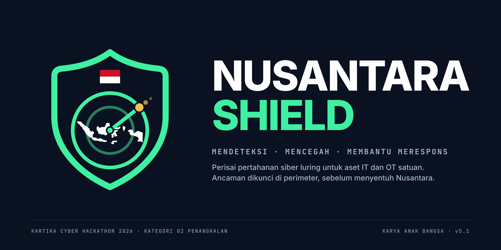
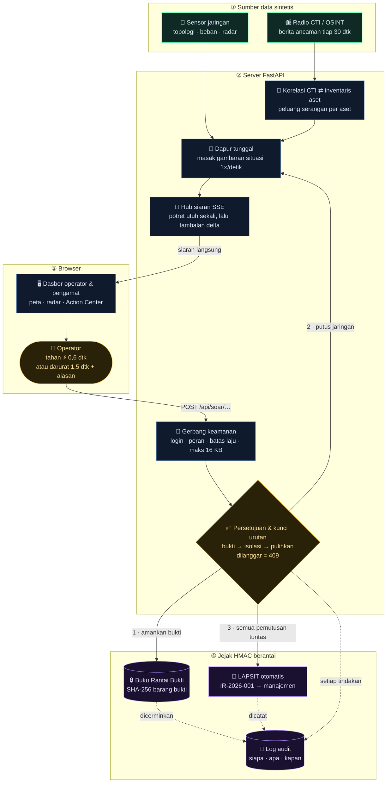
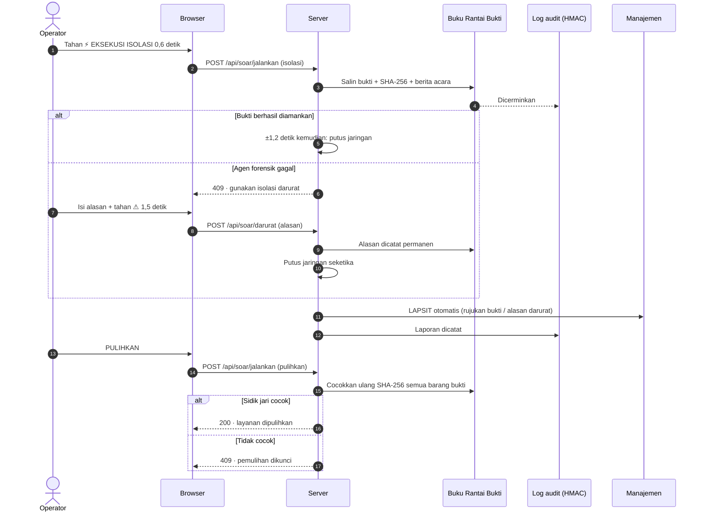

# Nusantara Shield v5.1

<p align="center"></p>

> **Perisai pertahanan (_Defensive Shield_) luring yang mendeteksi, mencegah, dan membantu merespons serangan siber: memperingatkan lebih dulu, memutus dalam 1,2 detik, dan tidak pernah menghapus barang bukti.**

Dasbor pusat operasi keamanan siber (SOC) **defensif** untuk Kartika Cyber Hackathon 2026, kategori 02 Penangkalan (*Defensive Shield*).
**Mendeteksi** (aturan deteksi, AI lokal, kabar ancaman) · **mencegah** (WASPADA dan Perketat) · **membantu merespons**
(bukti → isolasi → LAPSIT, otomatis setelah satu keputusan Operator; perintah ke perangkat masih simulasi).
*Server* FastAPI + browser Vanilla JS/Canvas, siaran langsung (SSE), dan jejak audit berantai HMAC.

Banyak sistem pertahanan berhenti di alarm. Nusantara Shield berlanjut sampai bukti tersegel, jalur terputus, dan LAPSIT terbit, dan otaknya (aturan deteksi, AI lokal, korelasi kabar ancaman) berjalan di *server* satuan sendiri, sehingga tidak ikut lumpuh saat koneksi internasional terganggu. Setiap klaim dikunci **298 uji** yang bisa dijalankan ulang siapa pun; angka di dasbor bukan animasi, dan asal setiap angka serta peta lima kriteria penilaian ada di [Proposal §7](docs/01-Proposal-Solusi-Nusantara-Shield.md#7-peta-kriteria-penilaian-dan-asal-angka).

- **Isolasi tidak pernah otomatis.** Isolasi otomatis terdengar cepat, sampai ia memutus segmen OT karena alarm keliru. Di sini isolasi selalu didahului bukti tersegel dan keputusan Operator; yang diputus jalurnya, genset tetap menyala.
- **"Tanpa awan" berlaku sampai ke demonya.** Aplikasi dipasang dari paket bersidik jari tanpa internet, lalu seluruh uji dijalankan di mesin itu juga.
- Semua data **sintetis**: alamat IP dari blok dokumentasi RFC 5737, nama orang & instansi **fiktif**.
- Berjalan **luring** (tanpa internet): tidak ada CDN, font, atau gambar dari luar.
- Tidak menyimpan data pribadi; log audit tidak menyimpan alamat IP pengunjung.

## Struktur Repositori

```
app/            kode server: FastAPI, dapur situasi, rantai bukti, LAPSIT, AI lokal
static/         dasbor (HTML, CSS, JavaScript polos; tanpa pustaka luar atau CDN)
tests/          298 uji otomatis (pytest), dijalankan dengan ./run_tests.sh
tools/          alat bantu: pengemasan rilis, paket pasang luring, perbaikan .venv
docs/           Proposal, Dokumentasi Teknis, Panduan Belajar (PDF), contoh LAPSIT dan log, diagram alur, logo
presentation/   dek presentasi: index.html (satu berkas mandiri, bisa dibuka luring)
LICENSE         GNU GPL v3.0 (GPL-3.0-only)
CHANGELOG.md    riwayat versi v1.0 (15 Okt 2026) sampai v5.1 (15–27 Okt 2026)
```

> **Folder proyek dipindah lalu muncul `cannot execute: No such file or directory` atau `No module named 'numpy'`?**
> `.venv` mencatat jalur folder secara mutlak sehingga rusak bila dipindah. Jalankan `bash tools/perbaiki_venv.sh`, lalu `source .venv/bin/activate` dan `./run_tests.sh`.

## Daftar isi

1. [Cara menjalankan](#1-cara-menjalankan)
2. [Akun & peran](#2-akun--peran)
3. [Bagaimana data mengalir](#3-bagaimana-data-mengalir)
4. [Isi dasbor](#4-isi-dasbor)
5. [Doktrin penanganan insiden](#5-doktrin-penanganan-insiden)
6. [Menjalankan uji otomatis](#6-menjalankan-uji-otomatis)
7. [Loket API](#7-loket-api)
8. [Lapisan keamanan](#8-lapisan-keamanan)
9. [Struktur berkas](#9-struktur-berkas)
10. [Catatan data & langkah berikutnya](#10-catatan-data--langkah-berikutnya)

---

## 1. Cara menjalankan

**Prasyarat:** Python 3.10 atau lebih baru.

> **Penting — folder `.venv` tidak ikut repositori/zip.** `.venv` adalah "ruang kerja" Python yang
> dirakit khusus untuk satu komputer (berisi path dan versi Python komputer itu), sehingga pasti rusak
> bila disalin ke komputer lain. Setiap orang membuatnya sendiri dengan langkah 2 di bawah.
> `.venv/` sudah tercantum di `.gitignore`.

### macOS / Linux

```bash
# 1. Masuk ke folder proyek
cd nusantara-shield-v5.1

# 2. Buat ruang kerja Python milik Anda sendiri (sekali saja)
python3 -m venv .venv
source .venv/bin/activate

# 3. Pasang perlengkapan
pip install -r requirements.txt

# 4. Nyalakan server
python -m uvicorn app.main:app --host 127.0.0.1 --port 8000 --no-access-log --no-server-header
```

### Windows (PowerShell)

```powershell
cd nusantara-shield-v5.1
python -m venv .venv
.venv\Scripts\Activate.ps1          # CMD: .venv\Scripts\activate.bat
pip install -r requirements.txt
python -m uvicorn app.main:app --host 127.0.0.1 --port 8000 --no-access-log --no-server-header
```

Buka **http://127.0.0.1:8000**. Sandi sementara akun bawaan `operator` dan `pengamat` tercetak di
terminal saat *server* menyala. Dua opsi pada perintah uvicorn sengaja dipakai:

- `--no-access-log` — alamat IP pengunjung tidak dicatat (minimisasi data).
- `--no-server-header` — *server* tidak mengumumkan mereknya kepada penyerang.

### Mode permanen (opsional)

Salin `.env.example` menjadi `.env`, isi nilainya, lalu jalankan uvicorn dengan `--env-file .env`
(perlu `pip install python-dotenv`). Dengan `NS_AUDIT_KEY` terisi, log audit, buku rantai bukti, akun
terdaftar, dan nomor laporan tersimpan di folder `data/` dan selamat dari restart.

### Mengemas zip untuk juri / repositori

```bash
python tools/kemas_rilis.py            # → dist/nusantara-shield-v5.1.zip
python tools/kemas_rilis.py --periksa  # hanya menampilkan daftar berkas
```

Alat ini membuang `.venv/`, `data/`, `.env`, cache, dan sampah sistem (`.DS_Store`, `__MACOSX`) —
aturan yang sama dengan `.gitignore`. Hasilnya ±160 KB, bukan ±28 MB.

### Paket pasang luring (jaringan *air-gapped*)

Untuk posko yang sama sekali tidak tersambung internet, kode dan seluruh pustaka (berkas `.whl`) dikemas menjadi satu zip beserta daftar sidik jari SHA-256 (`SHA256SUMS`). Pemasangan berhenti bila satu berkas saja berbeda.

```bash
# 1) Di komputer yang terhubung internet (sekali saja; pilih platform posko):
python tools/kemas_luring.py --platform win_amd64 --python 3.12           # posko Windows 64-bit
python tools/kemas_luring.py --platform macosx_14_0_arm64 --python 3.12   # posko Mac Apple Silicon
python tools/kemas_luring.py                                              # posko sama dengan komputer ini
#    → dist/nusantara-shield-v5.1-luring-<platform>.zip + dua sidik jari untuk berita acara

# 2) Di posko tanpa internet: ekstrak zip, masuk ke foldernya, lalu
python pasang_luring.py --periksa-saja    # cocokkan sidik jari SHA256SUMS dengan berita acara
python pasang_luring.py                   # buat .venv, pasang dari wheels/ (--no-index), jalankan uji
```

Batas: versi Python di posko harus sama dengan `--python`, dan ukuran paket ±50–80 MB per platform.

---

## 2. Akun & peran

| Peran | Boleh | Cara mendapatkan akun |
| --- | --- | --- |
| **Pengamat** | Melihat seluruh dasbor | Bawaan `pengamat`, **atau daftar sendiri** lewat "Buat akun" di halaman masuk |
| **Operator** | Melihat + memicu latihan, isolasi, pemulihan, mengelola akun | Bawaan `operator`, **atau** daftar sendiri dengan **kode undangan** (`NS_KODE_OPERATOR`), **atau** dibuatkan operator lain dari tab **Akun** |

- Nama akun 3–20 karakter (huruf kecil, angka, `_`, diawali huruf); kata sandi minimal 12 karakter dan
  tidak boleh memuat nama akun. Sandi disimpan sebagai hash PBKDF2 (200.000 putaran) + garam acak.
- Tanpa `NS_KODE_OPERATOR`, pendaftaran operator mandiri **tertutup**: akun yang bisa memutus jaringan
  tidak boleh dicetak sendiri oleh siapa pun.
- Pendaftaran dibatasi 5 kali per 5 menit per alamat. `NS_DAFTAR_PENGAMAT=0` menutup pendaftaran pengamat.
- **Tab Akun (khusus operator)** menampilkan jumlah pengamat **terdaftar**, **sedang login**, dan
  **sedang memantau** dasbor (siaran terbuka), diperbarui otomatis tiap 5 detik, plus formulir tambah akun.

---

## 3. Bagaimana data mengalir

Gambar statis (untuk penampil yang tidak mendukung Mermaid): [`docs/alur-data.svg`](docs/alur-data.svg),
[`docs/urutan-insiden.svg`](docs/urutan-insiden.svg).



**Cara membacanya:** data dari sensor & radio CTI (①) dimasak SEKALI per detik oleh *server* (②) lalu
disiarkan ke semua layar (③). Ketika operator menekan tombol, perintahnya melewati gerbang keamanan dan
kunci urutan; setiap keputusan meninggalkan jejak di buku-buku berantai HMAC (④) yang tidak bisa diubah
diam-diam.

### Urutan saat insiden ditangani



---

## 4. Isi dasbor

| Bagian | Fungsinya | Analogi |
| --- | --- | --- |
| Executive Overview | Postur AMAN/WASPADA/KRITIS, kartu **Kesiapan Siber** A–E (Kerawanan dan Insiden, per layanan), KPI, sakelar **Peta Global (Makro)** ⇄ **Topologi Internal (Mikro)** | Satelit pemantau & denah markas |
| Peta Ancaman Global | Peta dunia titik-titik; trayektori dari wilayah asal (fiktif) ke markas | Satelit pemantau |
| Radar Anomali | Jarak dari pusat = **zona jaringan**, warna/bentuk = **keparahan**, arah = penanda tetap per alamat IP (**bukan** geografis). Legenda "Cara membaca radar" + tooltip pada titik & cincin | Penjaga malam bersenter |
| Prediksi CTI + AI | Berita ancaman sintetis → korelasi port ke inventaris aset (IT **dan OT**) → peluang serangan; ≥ 50% = waspada proaktif. **AI lokal** (Isolation Forest) menilai lalu lintas tiap aset dan menambah peluang bila tidak wajar, lengkap dengan alasan. Tombol **Latihan OT** menyiarkan kabar Modbus; tombol **Latihan AI** menyuntikkan lalu lintas Modbus tak wajar ke genset. **Tutup peringatan** (Operator): *False Positive* atau Selesai ditangani, wajib beralasan | Alarm rumah, radio satpam, & satpam yang hafal suasana normal |
| Action Center | Satu kartu per insiden: status bukti, ⚡ isolasi, isolasi darurat, langkah playbook, ♻ pemulihan | Panel komando |
| Beban Jaringan | Gauge, **linimasa 60 menit** (berlabel data latihan, garis ambang waspada/kritis) dan **pita anomali AI per aset** (klik → sorot di topologi) | Meteran air |
| Peringatan terbaru | **Tabel lebar penuh**: keparahan, peringatan, aset, status, waktu. Label dari data nyata (Operator dan nomor bukti), tag teknik **MITRE ATT&CK**, dan **sumber data** tiap peringatan (latihan sintetis atau log impor) | Papan pengumuman piket |
| Latihan | Satu bilah alat: target, 4 skenario, latihan deteksi (*login* gagal, pindai *port*, akses OT tanpa izin), **Impor log…** (log asli: auth.log, firewall, CSV; contoh di `docs/contoh-log/`), latih kegagalan forensik | Simulator latihan |
| Aset (triase) | Status 6 layanan contoh; klik untuk laci PIC & Quick Call | Papan triase IGD |
| Log | Peristiwa dari *server* (ringkas 2 baris ⇄ semua) | Rekam gejala pasien |
| Alat operator | Cek indikator, kepatuhan backup, Audit & LAPSIT PDF, **Akun** (khusus operator) | Pos satpam & buku piket |

---

## 5. Doktrin penanganan insiden

| Aturan | Cara sistem menegakkannya |
| --- | --- |
| **Pre-authorized containment** | Isolasi tidak menunggu izin; tombol ⚡ cukup **ditahan 0,6 detik** (mencegah klik tak sengaja) |
| **Bukti sebelum pemutusan** | Setiap playbook diawali *Amankan bukti*: salinan (simulasi), SHA-256 tiap berkas, berita acara di Buku Rantai Bukti. Pemutusan tanpa bukti ditolak **409** di semua jalur |
| **Isolasi darurat** | Bila bukti gagal diamankan: alasan tertulis (min. 15 karakter) + tahan **1,5 detik**. Alasan tercatat di Buku Rantai Bukti, log audit, dan LAPSIT |
| **LAPSIT otomatis** | Terbit hanya setelah SEMUA tindakan pemutus tuntas; nomor `IR-2026-001` tidak pernah berulang (+ UUID) |
| **LAPSIT kapan saja** | *Ekspor LAPSIT (PDF)* di tab Audit & LAPSIT bisa dipakai kapan pun, termasuk saat kondisi normal sebagai **laporan rutin**: status layanan, insiden aktif (bila ada), peringatan terbaru dengan teknik ATT&CK, integritas log audit, dan blok pengesahan dua tanda tangan. Setiap halaman berkop logo Nusantara Shield, bernomor laporan, dan bernomor halaman. Contoh hasilnya ada di [`docs/contoh-lapsit/`](docs/contoh-lapsit/) |
| **Pemulihan terkunci** | Pintu terpisah; terbuka hanya bila aset terisolasi, playbook dicentang, dan SHA-256 bukti **cocok ulang** |
| **Isolasi OT** | Skenario *Sabotase OT*: bukti diamankan, lalu webhook (simulasi) ke sakelar terkelola memutus uplink kantor → zona kendali ± 1,2 detik. Genset **tidak dimatikan**; beralih ke kendali lokal (NIST SP 800-82) |
| **Kamus istilah** | Semua label dari `app/istilah.py` (kini istilah satuan: Dansat, Kasi Siber, TTIS Satuan); mengganti terminologi tidak memecahkan uji |

Latihan kegagalan forensik: centang **"Latih kegagalan agen forensik"** di panel Latihan sebelum memicu skenario.

---

## 6. Menjalankan uji otomatis

```bash
./run_tests.sh              # macOS / Linux  (otomatis memakai .venv bila ada)
run_tests.bat               # Windows
python -m pytest            # cara langsung; pengaturan tampilan ada di pytest.ini
```

Setiap uji dicetak **satu baris beserta hasilnya** (`PASSED`/`FAILED`) dan persentase kemajuan; judul
kelompok muncul setiap kali pytest pindah bagian, dan di akhir tampil ringkasan + 5 uji paling lambat.
Contoh memilih sebagian: `./run_tests.sh -k akun`, `./run_tests.sh tests/test_rantai_bukti.py`,
`./run_tests.sh --lf` (ulangi yang gagal). **Jangan memakai `-q`** — opsi itu menyembunyikan nama uji.

**Total: 298 uji** dalam 15 kelompok.

**Keamanan & akses** — `tests/test_keamanan.py` (38 uji)
- Semua loket menolak permintaan tanpa login; token palsu & sandi salah ditolak; logout mencabut token
- Pengamat tidak bisa mengubah data; tebak sandi dibatasi 5×/menit
- Input aneh & indikator tidak valid ditolak; kiriman > 16 KB ditolak sebelum mencapai router (termasuk *chunked*)
- Header keamanan terpasang (juga pada penolakan); dokumentasi API dimatikan; CORS menolak situs asing
- Log audit menyimpan data seminimal mungkin dan mendeteksi manipulasi; LAPSIT PDF terbentuk

**Manajemen akun** — `tests/test_akun.py` (18 uji)
- Pengamat bisa daftar sendiri lalu login, tetapi hanya bisa melihat
- Operator tanpa kode undangan / dengan kode salah ditolak; dengan kode sah bisa bertindak
- Validasi nama & sandi; nama ganda dan kolom asing ditolak; pendaftaran dibatasi laju
- Dasbor operator menghitung pengamat terdaftar / login / memantau; pengamat tidak bisa melihatnya
- Sandi tidak pernah tercatat di log maupun berkas; akun terdaftar bisa dimuat ulang setelah restart

**Telemetri & siaran** — `tests/test_telemetri.py` (19 uji)
- DDoS menggerakkan semua panel; langkah playbook memutus kabel di peta & radar; kronologi diteteskan bertahap
- Siaran menutup diri saat logout; jumlah siaran per akun dibatasi
- Satu dapur: biaya tidak bertambah dengan jumlah layar; dapur tetap hidup walau satu masakan gagal
- Tambalan delta: layar yang merakit tambalan selalu identik dengan *server*, dan tambalan jauh lebih kecil

**Intelijen ancaman & SOAR** — `tests/test_cti_soar.py` (18 uji)
- Berita relevan menaikkan aset ke waspada sebelum serangan; berita tak relevan hanya dicatat; berita memudar
- Pengerasan menurunkan peluang; peringatan dini terbukti
- SOAR memutus kabel & memotong beban seketika; isolasi bertahap lalu pemulihan lewat pintu terpisah
- Peta global selalu sinkron dengan topologi

**Sinergi IT/OT** — `tests/test_ot.py` (6 uji)
- Pengendali genset (Modbus/TCP, port 502) terdaftar di topologi (zona kendali), radar, dan profil Kendali Fasilitas
- Kabar ancaman Modbus menaikkan genset ke waspada (± 66%) sebelum ada serangan
- Perketat menurunkan peluang genset di bawah ambang
- Kabar OT tidak memicu aset IT, dan sebaliknya (tidak ada alarm palsu)
- Sabotase OT: bukti dulu, lalu webhook (simulasi) ke sakelar terkelola memutus uplink kantor → zona kendali ± 1,2 detik; genset tetap menyala (kendali lokal)
- Pemulihan jalur kendali terkunci bila sidik jari bukti tidak cocok

**AI lokal: deteksi anomali** — `tests/test_ai.py` (10 uji)
- Model Isolation Forest dilatih di server ini dengan benih tetap (hasil sama setiap menyala, dapat diaudit)
- Lalu lintas wajar tidak memicu alarm palsu; lalu lintas Modbus tak wajar menaikkan genset ke waspada tanpa kabar CTI
- Setiap deteksi disertai alasan ("perintah tulis Modbus 10× normal"); skor AI digabung dengan CTI: 1 − (1 − p_CTI)(1 − p_AI)
- Perketat menurunkan peluang AI di bawah ambang; latihan berakhir → lalu lintas dicatat kembali wajar
- Penilaian 9 aset dalam milidetik dan disimpan per keadaan; berjalan tanpa satu pun koneksi jaringan
- Hanya operator yang boleh menjalankan latihan AI; aset dalam insiden tetap diurus playbook

**Rantai komando & laporan** — `tests/test_komando.py` (22 uji)
- Isolasi tanpa menunggu izin; LAPSIT terkirim otomatis dengan keparahan & nomor berurutan
- Laporan hanya terbit setelah SEMUA pemutus selesai, tepat satu kali (juga bila manual)
- Pemulihan terkunci sampai terisolasi & playbook dicentang; Quick Call ke admin cabang
- Nomor laporan tidak berulang setelah reset maupun restart

**Rantai bukti forensik** — `tests/test_rantai_bukti.py` (36 uji, termasuk skenario Sabotase OT)
- Setiap playbook diawali *Amankan bukti*; isolasi standar mengamankan bukti sebelum memutus
- Semua jalan pintas (aksi tunggal, centang manual, antrean disusupkan) ditolak 409 tanpa bukti
- Isolasi darurat menolak alasan kosong; alasannya terikat ke buku bukti, log audit, dan LAPSIT
- Bukti atau berita acara yang dirusak → pemulihan dikunci di semua pintu

**Kamus istilah** — `tests/test_istilah.py` (36 uji)
- Tidak ada label yang tertanam di luar `app/istilah.py`; playbook dirakit dari kamus

**Engine Deteksi Aturan** — `tests/test_deteksi.py` (24 uji)
- Ambang terbuka dikunci: 8 _login_ gagal dalam 60 dtk (ke-7 belum, ke-8 terdeteksi), _login_ tembus ≤ 120 dtk, 15 kombinasi aset:port dalam 10 dtk
- Di bawah ambang, di luar jendela, atau port yang sama berulang: tidak ada temuan; rentetan berlanjut tidak menggandakan temuan
- Temuan hanya menaikkan WASPADA (tanpa isolasi/SOAR); Perketat, triase, kedaluwarsa 300 dtk; label isolasi = Operator + nomor bukti sebenarnya

**Aturan OT, label MITRE ATT&CK, sumber data, dan pengesahan LAPSIT** — `tests/test_ot_mitre_lapsit.py` (23 uji)
- Koneksi ke zona kendali dari alamat yang tidak terdaftar → temuan; jalur resmi dan perintah baca Modbus → bukan temuan
- Perintah tulis Modbus di luar jendela pemeliharaan 22.00–02.00 → temuan kritis (diuji per jam); koneksi tanpa izin disusul tulis → rantai IT → OT
- Dua kunci utuh: latihan Akses OT hanya menaikkan genset ke WASPADA, tanpa insiden, bukti, atau isolasi; hanya Operator yang boleh memutarnya
- Setiap aturan dan skenario berlabel MITRE ATT&CK (AI sengaja tanpa label); setiap peringatan menulis sumber datanya
- LAPSIT PDF memuat teknik ATT&CK, label sumber data, dan blok pengesahan dua tanda tangan

**Impor log luring** — `tests/test_impor_log.py` (18 uji)
- auth.log OpenSSH, log firewall UFW/iptables, dan CSV dibaca menjadi peristiwa mentah; nama akun tidak disalin
- Baris dengan IP, port, jenis, waktu, atau aset tidak sah dilewati dan dihitung; berkas tak dikenali ditolak 422
- Aturan yang sama dengan latihan: auth.log → *login* gagal + *login* tembus; CSV OT → tiga temuan OT; firewall → pemindaian *port*
- Dua kunci utuh: hanya WASPADA, tanpa insiden, bukti, atau isolasi; log audit hanya mencatat nama berkas dan jumlah
- Hanya jalur impor yang boleh ±2 MB, dan hanya bila membawa token; jalur lain tetap 16 KB; dibatasi 6 kali per menit

**Linimasa & KPI** — `tests/test_linimasa.py` (6 uji)
- 60 menit data latihan berbenih tetap tanpa kejadian karangan; tiap 60 dtk satu titik posko; menit insiden ditandai
- Pita anomali AI menyebut aset dan alasan, lalu berakhir; KPI MTTC dan insiden dihitung dari kejadian nyata

**Triase & Kesiapan Siber** — `tests/test_triase_kesiapan.py` (16 uji)
- Nilai Kesiapan Siber mengikuti rumus terbuka: dua sub-skor (Kerawanan, Insiden), nilai = yang lebih rendah, huruf A–E
- Kabar ancaman menurunkan nilai; Perketat memulihkannya; insiden yang belum ditahan membatasi nilai posko paling tinggi D
- Penutupan peringatan (Selesai ditangani atau Positif Palsu (*False Positive*)) wajib beralasan dan hanya untuk Operator
- Tidak ada yang dihapus: penutupan = halaman baru di Buku Rantai Bukti + log audit; bukti baru membuka peringatan lagi

---

## 7. Loket API

Semua loket di bawah `/api/` wajib login kecuali yang ditandai *publik*. Loket yang mengubah data
dibatasi lajunya dan dicatat di log audit.

| Loket | Peran | Fungsi |
| --- | --- | --- |
| `POST /api/login` · `POST /api/logout` | publik · semua | Masuk (token 8 jam) / keluar |
| `POST /api/akun/daftar` | publik | Daftar mandiri `{nama, sandi, peran, kode_operator?}` |
| `POST /api/akun` | operator | Operator membuat akun `{nama, sandi, peran}` |
| `GET /api/akun/ringkasan` | operator | Jumlah & daftar akun (terdaftar / login / memantau) |
| `GET /api/telemetri` · `GET /api/telemetri/siaran` | semua | Potret situasi · siaran langsung SSE (tambalan delta) |
| `POST /api/simulasi` | operator | Picu latihan `{layanan_id, skenario, gangguan_bukti?}` |
| `POST /api/soar/jalankan` | operator | `aksi` = `isolasi` · `pulihkan` · `amankan_bukti` · id tindakan |
| `POST /api/soar/darurat` | operator | Isolasi darurat `{layanan_id, alasan}` |
| `POST /api/soar/perketat` | operator | Pengerasan proaktif aset `{aset_id}` |
| `POST /api/peringatan/tutup` | operator | Triase: tutup peringatan WASPADA `{aset_id, status: selesai \| false_positive, alasan}`; dicatat di Buku Rantai Bukti |
| `POST /api/ai/latihan` | operator | Latihan AI lokal: suntik pola lalu lintas tak wajar `{aset_id, pola?}` (data sintetis) |
| `POST /api/deteksi/latihan` | operator | Latihan deteksi: putar peristiwa mentah sintetis `{jenis: login_gagal \| login_tembus \| pindai_port \| akses_ot, aset_id?}` |
| `POST /api/deteksi/impor` | operator | Impor log ASLI secara luring `{nama, isi, aset_id?}`: auth.log OpenSSH, log firewall UFW/iptables, atau CSV (maks. ±2 MB; 6× per menit). Aturan sama dengan latihan; hanya menaikkan WASPADA |
| `POST /api/playbook/langkah` · `POST /api/pulihkan` | operator | Centang langkah · tutup insiden |
| `POST /api/cti/siarkan` | operator | Siarkan berita CTI sekarang (`NS_CTI_JEDA`, bawaan 30 dtk) |
| `POST /api/komando/panggil` | operator | Quick Call ke PIC cabang (simulasi) |
| `GET /api/bukti` | semua | Buku Rantai Bukti + verifikasi rantai |
| `GET /api/audit` · `GET /api/audit/verifikasi` | semua | Log audit + verifikasi rantai |
| `POST /api/lapsit` | semua | Ekspor LAPSIT PDF |
| `POST /api/indikator/cari`, `/api/backup/catat`, `/api/demo/majukan-waktu`, `/api/reset-demo` | campuran | Alat operator |
| `GET /api/health` · `GET /api/istilah` | publik | Status minimal · kamus label |

---

## 8. Lapisan keamanan

| Syarat | Penerapan | Berkas |
| --- | --- | --- |
| Autentikasi | Token acak 8 jam; *server* hanya menyimpan hash token; sandi PBKDF2 200.000 putaran | `app/keamanan.py` |
| Otorisasi | Peran `pengamat` (lihat) dan `operator` (lihat, ubah, kelola akun) | `app/keamanan.py` |
| Pendaftaran aman | Operator hanya dengan kode undangan atau oleh operator; pembatasan laju | `app/keamanan.py`, `app/main.py` |
| Batas laju | Login 5/menit, daftar 5/5 menit, ubah 30/menit, PDF 5/menit, baca 120/menit | `app/keamanan.py` |
| Batas ukuran | Kiriman > 16 KB ditolak di middleware ASGI sebelum router | `app/keamanan.py` |
| Header keamanan | CSP ketat, nosniff, anti-iframe, no-referrer, HSTS bila HTTPS | `app/keamanan.py` |
| Validasi input | Pydantic `extra="forbid"`, daftar nilai tetap, batas panjang | `app/main.py` |
| Anti-XSS | Semua teks dipasang via `textContent` | `static/app.js` |
| Jejak audit | Dua buku berantai HMAC-SHA256 (log audit & Buku Rantai Bukti) | `app/audit.py`, `app/bukti.py` |
| Siaran aman | Token di header (bukan URL), diperiksa ulang tiap 2 detik; maks 4 siaran/akun | `app/main.py` |

Batas yang perlu diketahui: *server* berjalan sebagai **satu proses** (Hub siaran ada di memori proses itu).

Model ancaman terhadap posko itu sendiri beserta batasnya ada di Dokumentasi Teknis §2.7, dan pemetaan fitur ke NIST Cybersecurity Framework (CSF) 2.0 di §2.6.

---

## 9. Struktur berkas

```
app/main.py           loket-loket API
app/keamanan.py       akun, pendaftaran, token, peran, batas laju, middleware
app/audit.py          buku berantai HMAC (dipakai log audit & Buku Rantai Bukti)
app/bukti.py          brankas bukti, SHA-256, berita acara
app/telemetri.py      "dapur": topologi, dampak skenario, SOAR, radar, CTI, kunci urutan
app/ai_anomali.py     AI lokal: Isolation Forest (scikit-learn), dilatih & dijalankan di server ini
app/siaran.py         Hub siaran tunggal
app/delta.py          tambalan delta untuk siaran
app/istilah.py        kamus label (satu-satunya sumber istilah)
app/penomoran.py      nomor laporan & berita acara yang tidak pernah berulang
app/data_contoh.py    data sintetis, skenario, playbook
app/lapsit.py         pembuat PDF
static/index.html     kerangka dasbor
static/app.js         login & pendaftaran, siaran, semua panel, alat operator
static/radar.js       Radar Anomali (Canvas)
static/peta.js        Peta Ancaman Global (Canvas)
static/penjadwal.js   satu mesin animasi berbasis visibilitas
static/style.css      tema gelap + aksen hijau neon
docs/                 diagram alur (sumber Mermaid + SVG)
tests/                298 uji otomatis (lihat bagian 6)
tools/kemas_rilis.py  pembuat zip rilis bersih
tools/buat_peta.mjs   pembuat titik peta dunia (sekali pakai)
run_tests.sh / .bat   menjalankan uji dengan umpan balik per uji
pytest.ini            pengaturan tampilan pytest
```

---

## 10. Catatan data & langkah berikutnya

- IP memakai blok dokumentasi RFC 5737, domain `.example`/`.test` (RFC 2606); hash contoh = berkas uji **EICAR**.
- Titik daratan peta dibuat SEKALI oleh `tools/buat_peta.mjs` dari Natural Earth (domain publik). Wilayah asal
  serangan di peta **fiktif**, bukan atribusi pelaku sungguhan.
- Pengambilan bukti forensik adalah **simulasi**: isi "berkas" dibangkitkan acak agar sidik jarinya unik dan
  bisa diverifikasi; tidak ada memori atau log sungguhan yang disalin.

**Status fitur — jujur dan tegas.**

| Sudah berjalan (purwarupa v5.1) | Belum dibangun (peta jalan: Mode Hybrid dan eskalasi) |
| --- | --- |
| Operasi luring penuh di 1 satuan/RS (*on-premise*) | Pengiriman LAPSIT otomatis berjenjang ke Sansidam (Kodam) dan Kartika CSIRT (Pussiberad) |
| Peran Pengamat dan Operator | Akses dan tampilan lintas satuan untuk pemantauan serentak di Mabes |
| Isolasi dengan tombol ditahan 0,6 detik | Engine Asisten Narasi: LLM lokal (Llama 3 8B lewat Ollama) untuk draf LAPSIT |
| Rantai bukti HMAC-SHA256 | |
| Korelasi CTI dan Engine Deteksi Anomali (Isolation Forest, luring) | **Respons bertingkat menurut kritikalitas aset:** aset vital tetap dua kunci; endpoint kantor berisiko rendah diisolasi otomatis dengan praotorisasi |
| Engine Deteksi Aturan: login gagal berulang, login tembus, pemindaian port, aturan OT (atas peristiwa sintetis), dan **impor log asli** (auth.log, firewall, CSV) | Sensor yang terus-menerus (Wazuh, Suricata, Zeek) dan peristiwa identitas dari Active Directory |
| Linimasa 60 menit (data latihan), pita anomali AI per aset, KPI MTTC dan insiden | |
| Simulasi OT genset (Modbus 502) | |
| Pembuatan LAPSIT dan ekspor PDF | |
| Paket pasang luring bersidik jari SHA-256 (tanpa internet sama sekali) | |

**Langkah berikutnya (setelah lomba):**
1. Ganti data contoh dengan umpan indikator resmi (misalnya dari BSSN atau komunitas MISP).
2. Simpan status di basis data; Hub siaran di perantara pesan bersama agar bisa lebih dari satu proses.
3. Login lewat sistem identitas instansi (SSO) dengan verifikasi dua langkah.
4. Jalankan di belakang HTTPS (`NS_HTTPS=1`).
5. **Engine Deteksi Anomali (AI lokal) sudah berjalan** (`app/ai_anomali.py`). Yang masih **rencana**: Engine Asisten
   Narasi (LLM lokal Llama 3 8B lewat Ollama) untuk draf LAPSIT, serta otomasi alur kerja (n8n).
   Ciri lalu lintas AI di purwarupa masih sintetis; penerapan nyata mengambilnya dari sensor satuan (Wazuh, Suricata, Zeek).
6. Perluasan OT: sensor protokol industri (Modbus/DNP3) dan webhook ke sakelar terkelola **sungguhan**
   (di purwarupa, perintah sakelar masih simulasi) — **rencana**.

## Lisensi dan Hak Cipta

Copyright (c) 2026 Nusantara Shield Team (Muhammad Isa Ananta, Hasan Basri, Melia Fajar Hasanah).
Dikembangkan untuk Kartika Cyber Hackathon 2026.

Kode sumber dilisensikan di bawah **GNU General Public License v3.0** (`GPL-3.0-only`); teks lengkapnya ada di
[`LICENSE`](LICENSE), dan setiap berkas kode memuat penanda `SPDX-License-Identifier`. Artinya, siapa pun boleh
memakai, mempelajari, dan mengubah kode ini, asalkan turunannya yang disebarkan **tetap berlisensi GPLv3, terbuka
kode sumbernya, dan mencantumkan hak cipta tim**. Hak cipta atas karya tetap milik tim; lisensi non-eksklusif untuk
Penyelenggara diatur Rulebook bagian N.

Pustaka pihak ketiga (FastAPI, scikit-learn, ReportLab, ikon Lucide, dan lainnya) tetap tunduk pada lisensinya
masing-masing; daftarnya ada di Proposal §6.2. Nama dan logo Nusantara Shield (`docs/logo/`) dipakai untuk merujuk
proyek ini; mohon tidak dipakai sebagai merek produk lain.
