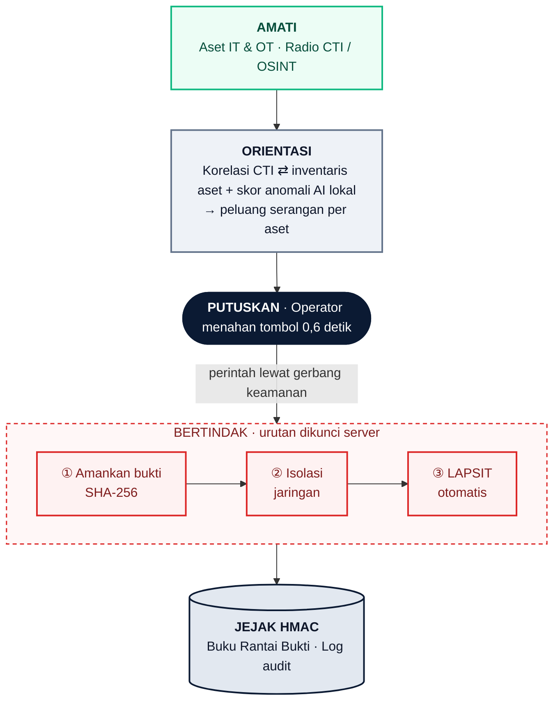
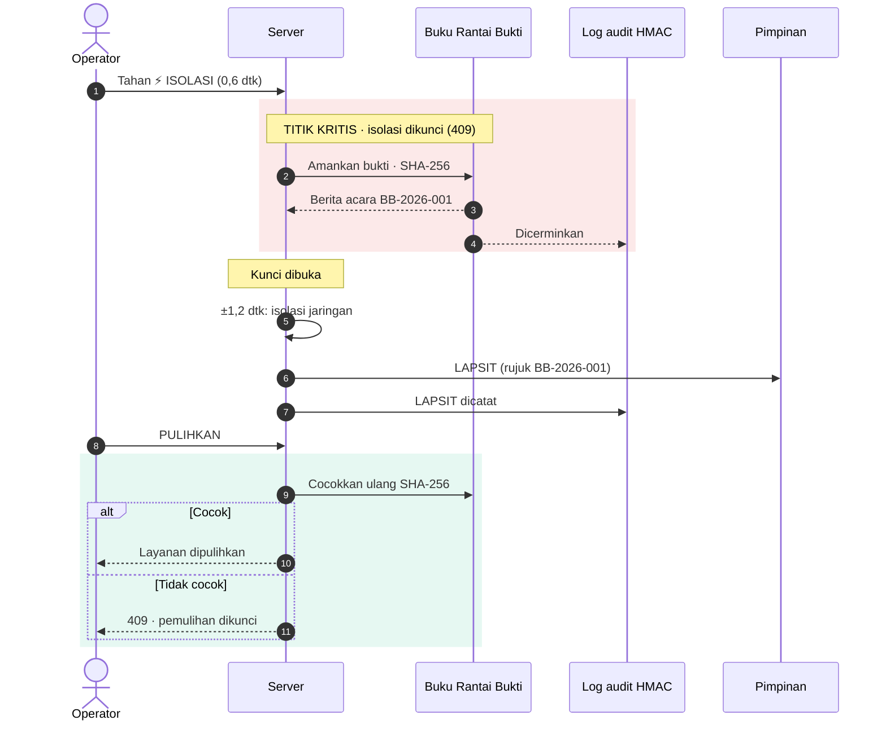

# Dokumentasi Teknis — Nusantara Shield v5.1

**Posko Pertahanan Siber Luring: Peringatan Dini, Isolasi Cepat, dan Rantai Bukti Forensik**

| | |
| --- | --- |
| **Versi** | 5.1 · Fase 7: aset rumah sakit, isolasi Operational Technology (OT), dan Engine Deteksi Aturan · 26 Oktober 2026 |
| **Status uji** | **298 / 298 uji otomatis lulus** · diverifikasi dari paket rilis bersih |
| **AI** | **Engine Deteksi Anomali berjalan lokal**: _Isolation Forest_ (scikit-learn), dilatih dan dijalankan di _server_ satuan, tanpa Application Programming Interface (API) luar |
| **Arsitektur** | _Server_ FastAPI (Python) · peramban Vanilla JS + Canvas · siaran langsung Server-Sent Events (SSE) · buku berantai HMAC-SHA256 |
| **Mode operasi** | **Luring penuh**: tanpa internet, Content Delivery Network (CDN), atau layanan awan saat berjalan |
| **Data** | Sintetis: Internet Protocol (IP) blok dokumentasi Request for Comments (RFC) 5737, nama orang dan satuan fiktif |

Nusantara Shield adalah perisai pertahanan siber (kategori **Penangkalan, _Defensive Shield_**) yang **mendeteksi** ancaman (Engine Deteksi Aturan, AI lokal, dan korelasi kabar ancaman), **mencegah** aset berisiko diserang (WASPADA dan Perketat), dan **membantu merespons** dengan urutan baku bukti → isolasi → LAPSIT yang berjalan otomatis setelah satu keputusan Operator. Di purwarupa, perintah ke perangkat jaringan masih simulasi.

**Status fitur.** Tabel ini membedakan dengan tegas apa yang sudah didemonstrasikan dan apa yang masih rencana.

| Sudah berjalan di purwarupa v5.1 | Belum dibangun (peta jalan: Mode Hybrid dan eskalasi) |
| --- | --- |
| Operasi luring penuh di satu satuan/rumah sakit (*on-premise*) | **(1) Pengiriman LAPSIT otomatis berjenjang** ke Sandi dan Siber Kodam (Sansidam) dan Kartika CSIRT (Pussiberad) |
| Dua peran: Pengamat dan Operator | **(2) Akses dan tampilan lintas satuan** untuk pemantauan serentak di Mabes |
| Isolasi dengan tombol yang ditahan 0,6 detik | Engine Asisten Narasi: LLM lokal Llama 3 8B lewat Ollama untuk draf LAPSIT |
| Rantai bukti HMAC-SHA256 | Umpan indikator resmi (BSSN/MISP) lewat gerbang satu arah |
| Korelasi CTI dan Engine Deteksi Anomali (_Isolation Forest_, luring) | Sensor nyata (Wazuh, Suricata, Zeek) dan sakelar terkelola sungguhan |
| Simulasi OT genset (Modbus, _port_ 502) | Peristiwa identitas nyata dari Active Directory (perubahan hak akses, akun baru) |
| Pembuatan LAPSIT dan ekspor PDF | Pengamanan integrasi nyata: brankas kredensial, hak minimum per _playbook_, _playbook_ bertanda tangan |
| Paket pasang luring bersidik jari SHA-256 (tanpa internet sama sekali) | **Respons bertingkat menurut kritikalitas aset:** aset vital tetap dua kunci; _endpoint_ kantor berisiko rendah diisolasi otomatis dengan praotorisasi |
| Engine Deteksi Aturan: _login_ gagal berulang, _login_ tembus, pemindaian _port_ (§2.8) | |
| Linimasa 60 menit (data latihan), pita anomali AI per aset, KPI MTTC dan insiden (§2.8) | |

---

## 1. Spesifikasi Lingkungan dan Dependensi

### 1.1 Kebutuhan Perangkat

| Komponen | Kebutuhan minimum | Catatan operasional |
| --- | --- | --- |
| **Sistem operasi** | Linux, macOS, atau Windows 10+ | Uji otomatis diverifikasi di Linux; Windows memakai `run_tests.bat` |
| **Python** | **3.10 atau lebih baru** | Satu-satunya _runtime_ yang perlu dipasang |
| **Prosesor** | 2 inti | Terukur **±1,5% Central Processing Unit (CPU)** saat siaga dan **±1,7%** saat serangan untuk 300 layar pemantau serentak (§2.3) |
| **Memori** | 512 MB bebas | Terukur **±207 MB** untuk 300 layar, termasuk pustaka AI (scikit-learn dan numpy, ±130 MB) |
| **Penyimpanan** | 50 MB | Paket rilis **187 KB**; sisanya pustaka Python |
| **Peramban** | Chrome, Edge, atau Firefox versi terbaru | Tanpa *plugin*; bekerja di jaringan tertutup |
| **Jaringan** | Internet sekali saat `pip install`, **atau tidak sama sekali** dengan paket pasang luring (4.4) | Setelah terpasang, seluruh operasi luring |
| **Port** | 8000/TCP (dapat diubah) | Hanya untuk akses dari jaringan internal satuan |

### 1.2 Dependensi Perangkat Lunak

| Pustaka | Versi | Fungsi dalam sistem |
| --- | --- | --- |
| **fastapi** | ≥0.115 | Loket API, validasi masukan, otorisasi per peran |
| **uvicorn[standard]** | ≥0.30 | _Server_ web asinkron (siaran langsung SSE) |
| **reportlab** | ≥4.0 | Ekspor laporan situasi (LAPSIT) ke PDF |
| **scikit-learn** | ≥1.3 | AI lokal: model _Isolation Forest_ untuk deteksi anomali (membawa numpy); berjalan luring |
| **pytest** | ≥8.0 | Menjalankan 298 uji otomatis |
| **httpx** | ≥0.27 | Klien uji untuk loket API |
| **hmac**, **hashlib**, **secrets** | bawaan Python | Segel HMAC-SHA256 berantai untuk log audit dan Buku Rantai Bukti, sidik jari SHA-256 barang bukti, dan kunci acak. Tidak memakai pustaka kriptografi pihak ketiga |

**Ringkasnya:** _server_ memakai **FastAPI**, AI lokal memakai **scikit-learn** (_Isolation Forest_), dan segel bukti memakai **HMAC-SHA256 dari pustaka bawaan Python**. Semuanya sumber terbuka dan dapat diperiksa baris per baris.

### 1.3 Pengaturan Utama (*Environment Variable*)

| Variabel | Fungsi | Bila tidak diisi |
| --- | --- | --- |
| `NS_OPERATOR_PASSWORD` · `NS_VIEWER_PASSWORD` | Sandi akun bawaan (min. 12 karakter) | Sandi acak dicetak sekali di terminal |
| `NS_AUDIT_KEY` | Kunci Hash-based Message Authentication Code (HMAC) buku audit dan buku bukti; mengaktifkan penyimpanan permanen | Buku hanya di memori (mode demo) |
| `NS_KODE_OPERATOR` | Kode undangan untuk mendaftar sebagai operator | Pendaftaran operator mandiri **tertutup** |
| `NS_DAFTAR_PENGAMAT` | `1` = siapa pun boleh mendaftar sebagai pengamat | Terbuka |
| `NS_HTTPS` | `1` = aktifkan HTTP Strict Transport Security (HSTS) di belakang Hypertext Transfer Protocol Secure (HTTPS) | Nonaktif |

### 1.4 Data Latihan Sintetis

Seluruh data di purwarupa **sengaja** sintetis agar aman didemonstrasikan di depan umum:

- **Alamat IP** memakai tiga blok khusus dokumentasi Request for Comments (RFC) 5737: `192.0.2.0/24`, `198.51.100.0/24`, dan `203.0.113.0/24`. Blok ini tidak pernah dipakai di internet sungguhan, sehingga tidak ada alamat milik pihak mana pun yang tercantum.
- **Nama domain contoh** memakai akhiran `.example` dan `.test` yang dicadangkan RFC 2606.
- **Sidik jari berkas berbahaya contoh** memakai berkas uji EICAR, berkas standar yang tidak berbahaya untuk menguji antivirus.
- **Nama orang, satuan, dan aset** fiktif; ciri lalu lintas yang dinilai AI dibangkitkan dari profil sintetis.
- **Peristiwa _login_ dan koneksi** untuk latihan deteksi dibangkitkan dari alamat dokumentasi (`203.0.113.77`, `198.51.100.66`, `192.0.2.150`).
- **Linimasa 60 menit** berlabel "data latihan": 60 menit sebelum posko dibuka dibangkitkan dengan benih tetap, tanpa insiden dan tanpa anomali karangan.

---

## 2. Arsitektur Alur Data

**Peran sistem: pendukung keputusan, bukan pengganti keputusan.** Nusantara Shield adalah sistem pendukung keputusan (SPK) bagi Operator. Mesin mengamati, mengorelasikan, menilai, dan menyiapkan langkah baku; manusia memutuskan; _server_ menjalankan keputusan itu dalam urutan yang dikunci. Sistem ini **sengaja tidak otonom penuh**. Di jaringan vital, respons otomatis penuh membuka tiga risiko: peringatan keliru yang memutus layanan sendiri, respons yang dapat dipancing pihak luar, dan pemutusan tanpa pejabat yang bertanggung jawab (lihat §3.4).

### 2.1 Alur Data dalam Siklus OODA



> **Cara membaca:** data mengalir dari atas ke bawah mengikuti siklus Observe–Orient–Decide–Act (OODA). **Satu-satunya titik keputusan adalah operator** (kuning). Semua yang di bawahnya dieksekusi mesin dalam urutan terkunci, dan setiap langkah meninggalkan jejak di buku berantai HMAC (ungu).

### 2.2 Komponen Sistem

| Komponen | Berkas | Tanggung jawab |
| --- | --- | --- |
| **Loket API** | `app/main.py` | Menerima perintah, validasi masukan, otorisasi per peran |
| **Gerbang keamanan** | `app/keamanan.py` | _Login_, token, peran, batas laju, batas ukuran kiriman 16 KB |
| **Engine Deteksi Aturan** | `app/deteksi.py` | Menghitung peristiwa mentah _login_ dan koneksi masuk dengan ambang terbuka; menghasilkan temuan `DET-…` (§2.8) |
| **Engine Deteksi Anomali (AI lokal)** | `app/ai_anomali.py` | Melatih _Isolation Forest_ dari profil lalu lintas normal saat _server_ menyala; menilai enam ciri lalu lintas tiap aset; menyusun alasan yang bisa dibaca |
| **Dapur situasi** | `app/telemetri.py` | Topologi (zona Information Technology (IT) dan zona kendali OT), korelasi Cyber Threat Intelligence (CTI), _playbook_ 4 skenario (termasuk Sabotase OT), **kunci urutan bukti → isolasi → pulihkan** |
| **Brankas bukti** | `app/bukti.py` | Salinan barang bukti, sidik jari Secure Hash Algorithm 256-bit (SHA-256), berita acara |
| **Buku berantai** | `app/audit.py` | HMAC-SHA256 berantai untuk log audit dan Buku Rantai Bukti |
| **Hub siaran** | `app/siaran.py`, `app/delta.py` | Satu siaran untuk semua layar; hanya ralat (delta) yang dikirim |
| **Dasbor** | `static/` | Peta, radar, kartu Kesiapan Siber, Action Center, alat operator, manajemen akun |

Dasbor menyajikan tiga lapis tampilan pusat komando siber: **_strategic heatmap_** (Peta Global, kotak Postur), **_operational incident board_** (Action Center, Laporan Situasi (LAPSIT)), dan **_tactical endpoint list_** (Topologi Internal, daftar aset).

### 2.3 Kinerja Terukur

**Versi akhir (26 Oktober 2026).** Diukur dengan `tools/ukur_beban.py`, yang dapat dijalankan ulang siapa pun: alat ini menyalakan _server_, membuka 300 siaran SSE sungguhan lewat HTTP, lalu mencatat waktu CPU proses _server_ selama 60 detik. Mesin: Linux 2 inti, Python 3.13. CPU 100% = satu inti penuh.

| Ukuran (300 layar serentak) | Siaga | Serangan (ransomware + DDoS, latihan AI dan deteksi) |
| --- | --- | --- |
| CPU _server_, sebelum linimasa dan KPI | 1,43% | 1,60% |
| CPU _server_, **versi akhir** | **1,47%** | **1,67%** |
| Lalu lintas siaran ke 300 layar | 0,28 MB/s | 0,40 MB/s |
| Memori proses _server_ (termasuk pustaka AI) | ±207 MB | ±207 MB |
| Siaran yang tetap hidup | 300/300 | 300/300 |

**Riwayat optimasi siaran ralat (uji beban 15–17 Oktober 2026, Uvicorn + Chromium, mesin dan alat ukur berbeda).** Angka ini menunjukkan efek optimasi, bukan beban versi akhir, sehingga tidak dibandingkan langsung dengan tabel di atas.

| Ukuran (300 layar serentak) | Sebelum optimasi | Sesudah |
| --- | --- | --- |
| CPU _server_ | 10,8% | 2,8% |
| Memori _server_ (sebelum AI) | 90 MB | 71 MB |
| Lalu lintas saat serangan intensif | 8,4 MB/s | **1,7 MB/s** (−80%) |
| Kerja grafis kanvas yang tidak terlihat | 44 ms/detik | **0 ms** |

Setelah AI lokal ditambahkan: melatih model ±0,16 detik sekali saat _server_ menyala; menilai 9 aset ±10 milidetik, hanya saat keadaan lalu lintas berubah (hasil disimpan per keadaan). Rata-rata tambahan kerja _server_ ±0,05 milidetik per detik.

### 2.4 Engine Deteksi Anomali (AI Lokal)

**Status: sudah beroperasi penuh di purwarupa, luring.** Engine ini mencari lalu lintas yang **tidak wajar** tanpa menunggu kabar CTI dan tanpa daftar _signature_ serangan.

| Bagian | Isi |
| --- | --- |
| **Model** | _Isolation Forest_ (scikit-learn): 100 pohon, benih acak tetap 2026 sehingga hasilnya dapat diulang dan diaudit |
| **Data latih** | 1.500 contoh lalu lintas **normal** sintetis, dibuat dan dilatih di _server_ saat menyala (±0,16 detik); tidak ada berkas model yang diunduh |
| **Enam ciri per aset** | Jumlah koneksi, volume data, ragam _port_ tujuan, _login_ gagal, operasi tulis (untuk genset: perintah tulis Modbus), porsi koneksi ke luar jaringan |
| **Skor** | 0 sampai 1. Lalu lintas wajar ±0,39; pola tidak wajar 0,61–0,70. **Ambang 0,58**. |
| **Ke peluang serangan** | p<sub>AI</sub> = min(0,95; 0,5 + (skor − 0,58) × 4), lalu digabung dengan CTI: **p = 1 − (1 − p<sub>CTI</sub>)(1 − p<sub>AI</sub>)**. **Perketat** memotong p<sub>AI</sub> sebesar 70%. |
| **Alasan (_explainability_)** | Dua ciri yang paling menyimpang ditulis dalam bahasa manusia, misalnya *"perintah tulis Modbus 10× normal, porsi koneksi ke luar jaringan 8× normal"* |
| **Batas wewenang** | AI hanya **menaikkan status** (WASPADA) dan mencatat di log. Ia tidak pernah memutus jaringan; keputusan tetap di tangan operator (_human-in-the-loop_). Aset yang sedang insiden diurus _playbook_, bukan prediksi AI. |

**_Local inference_ dan _air-gapped_ adalah dua hal berbeda.** _Local inference_ berarti model dihitung di _server_ sendiri, bukan lewat API di internet; engine ini memenuhinya sejak sekarang. _Air-gapped_ berarti jaringan satuan sama sekali tidak tersambung ke internet. Karena engine ini tidak membuka koneksi apa pun (dikunci uji yang memblokir _socket_), ia **siap** dipasang di jaringan _air-gapped_; paket pustakanya cukup dibawa lewat media yang sudah diperiksa.

**Peta jalan: Engine Asisten Narasi.** Model bahasa lokal (_Local LLM_) **Llama 3 8B lewat Ollama** untuk menyusun draf LAPSIT **belum ada** di purwarupa. Ia juga dirancang sebagai _local inference_; untuk satuan _air-gapped_, berkas modelnya diunduh sekali lalu dibawa lewat media yang diperiksa. Model berat ini sengaja tidak dimasukkan ke _server_ inti agar CPU tetap hemat; rencananya berjalan sebagai layanan terpisah di _server_ satuan dan drafnya tetap diperiksa operator.

> **Batas purwarupa:** ciri lalu lintas masih **sintetis**. Di lapangan, ciri yang sama diambil dari sensor jaringan (misalnya Zeek atau Suricata), lalu model dilatih ulang dari lalu lintas normal satuan itu sendiri.

---

### 2.5 Nilai Kesiapan Siber dan Triase Peringatan

**Status: sudah berjalan di purwarupa.** Dua fitur ini menjawab pertanyaan pimpinan, "seberapa siap kita sekarang?", dan pertanyaan operator, "alarm ini benar atau tidak?".

**Nilai Kesiapan Siber.** Setiap layanan (kelompok aset) diberi dua sub-skor 0–100; makin tinggi makin siap. Rumusnya sengaja sederhana dan terbuka di `app/telemetri.py`:

| Bagian | Rumus | Arti |
| --- | --- | --- |
| **Kerawanan** | 100 − 50 × rata-rata peluang serangan aset − 30 × porsi aset bertemuan konfigurasi − 20 × (backup terlambat atau belum diuji) | Seberapa terbuka layanan sebelum diserang |
| **Insiden** | 100 − 70 (insiden belum ditahan) atau − 40 (sudah ditahan, belum pulih) − 15 per peringatan WASPADA terbuka (maks. 30) | Seberapa genting keadaan saat ini |
| **Nilai layanan** | Yang lebih rendah dari kedua sub-skor | Rantai sekuat mata rantai terlemah |
| **Nilai posko** | Rata-rata tertimbang jumlah aset; selama ada insiden yang belum ditahan, paling tinggi D | Ringkasan untuk Dansat |

Huruf: **A** ≥ 90 · **B** ≥ 75 · **C** ≥ 60 · **D** ≥ 40 · **E** < 40. Pada keadaan awal demo, posko bernilai A (92); tiga layanan bernilai B karena backup terlambat, backup belum diuji, dan akses RDP yang terbuka. Kabar celah Modbus menurunkan Genset RS Kesdam ke C, dan Perketat menaikkannya kembali ke B.

**Triase peringatan.** Operator dapat menutup peringatan WASPADA dengan salah satu dari dua status: **Selesai ditangani** (ancaman sudah ditindak) atau **Positif Palsu (_False Positive_)** (alarm ternyata bukan ancaman).

- Alasan tertulis wajib, minimal 15 karakter. Hanya akun Operator yang dapat menutup; akun Pengamat ditolak (403).
- **Tidak ada yang dihapus.** Berita CTI dan penilaian AI tetap tercatat. Penutupan menjadi halaman baru `PERINGATAN_DITUTUP` di Buku Rantai Bukti (HMAC berantai) dan dicerminkan ke log audit.
- Yang berubah hanya ini: sumber-sumber yang ada saat penutupan tidak lagi menaikkan aset tersebut. **Bukti baru**, yaitu berita CTI lain atau episode anomali AI berikutnya, membuka peringatan lagi.
- Aset yang sedang dalam insiden aktif tidak bisa ditutup lewat triase; penanganannya tetap lewat _playbook_.
- Jumlah _False Positive_ ditampilkan terpisah dari Selesai ditangani, sebagai bahan _After-Action Review_ (AAR) untuk menyetel ambang CTI dan AI.

Loket: `POST /api/peringatan/tutup` dengan `{aset_id, status: "selesai" | "false_positive", alasan}`. Perilakunya dikunci 16 uji di `tests/test_triase_kesiapan.py`.

### 2.6 Pemetaan ke NIST CSF 2.0

**Status: pemetaan mandiri oleh tim, bukan sertifikasi atau audit kepatuhan.** _Cybersecurity Framework_ (CSF) 2.0 dari NIST (CSWP 29, terbit 26 Februari 2024) membagi program keamanan siber ke enam fungsi dan 22 kategori. Tabel ini hanya memuat kategori yang benar-benar disentuh Nusantara Shield, beserta uji yang membuktikannya.

| Kategori CSF 2.0 | Penerapan di Nusantara Shield | Status | Uji |
| --- | --- | --- | --- |
| **_Govern_** · GV.RR Peran dan wewenang | Peran Pengamat dan Operator; dua kunci konfirmasi; akun Operator hanya lewat kode undangan | Berjalan | `test_keamanan`, `test_akun` |
| **_Govern_** · GV.OV Pengawasan | Nilai Kesiapan Siber A–E untuk Dansat; ringkasan triase (_False Positive_ dipisah) sebagai bahan AAR | Berjalan | `test_triase_kesiapan` |
| **_Identify_** · ID.AM Aset | Inventaris dan topologi aset IT serta zona kendali OT | Berjalan (data sintetis) | `test_ot`, `test_telemetri` |
| **_Identify_** · ID.RA Penilaian risiko | Korelasi kabar ancaman × aset; peluang serangan per aset; sub-skor Kerawanan | Berjalan | `test_cti_soar`, `test_triase_kesiapan` |
| **_Protect_** · PR.AA Identitas dan akses | Akses ke posko itu sendiri: PBKDF2-SHA256, token kedaluwarsa, batas laju _login_ (§2.7) | Berjalan | `test_keamanan`, `test_akun` |
| **_Protect_** · PR.PS Keamanan platform | Perketat: model pengerasan aset yang diprediksi diserang | Simulasi; pengerasan perangkat nyata masih peta jalan | `test_cti_soar` |
| **_Protect_** · PR.DS Keamanan data | Kepatuhan backup < 24 jam dan uji pulih | Berjalan sebagai pencatatan | `test_keamanan` |
| **_Detect_** · DE.CM Pemantauan berkelanjutan | Beban jaringan dan linimasa 60 menit, radar, AI lokal yang menilai ciri lalu lintas setiap detik, serta peristiwa _login_ dan koneksi masuk yang dibaca Engine Deteksi Aturan | Berjalan atas data sintetis; sensor nyata dan peristiwa identitas dari Active Directory masih peta jalan | `test_ai`, `test_telemetri`, `test_deteksi`, `test_linimasa` |
| **_Detect_** · DE.AE Analisis kejadian | _Isolation Forest_ yang menyebut alasannya; aturan _login_ gagal berulang, _login_ tembus, dan pemindaian _port_ dengan ambang terbuka; korelasi CTI; triase peringatan | Berjalan | `test_ai`, `test_deteksi`, `test_triase_kesiapan` |
| **_Respond_** · RS.MA Manajemen insiden | Action Center, _playbook_ 4 skenario, isolasi praotorisasi; KPI Waktu respons (MTTC) | Berjalan | `test_telemetri`, `test_rantai_bukti`, `test_linimasa` |
| **_Respond_** · RS.AN Analisis insiden | Bukti disegel SHA-256 sebelum isolasi; berita acara bernomor | Berjalan (akuisisi disimulasikan) | `test_rantai_bukti` |
| **_Respond_** · RS.MI Mitigasi insiden | Isolasi IT dan jalur OT ±1,2 detik setelah bukti aman; isolasi darurat beralasan | Berjalan (pemutusan disimulasikan) | `test_rantai_bukti`, `test_ot` |
| **_Respond_** · RS.CO Pelaporan insiden | LAPSIT PDF; panggilan cepat ke PIC teknis | Berjalan; pengiriman berjenjang otomatis masih peta jalan | `test_keamanan`, `test_komando` |
| **_Recover_** · RC.RP Eksekusi pemulihan | Pemulihan terkunci sampai sidik jari bukti cocok ulang | Berjalan | `test_rantai_bukti` |

Kode kategori dan nama resminya mengikuti NIST CSWP 29; label berbahasa Indonesia di atas adalah ringkasan tim. Semua berkas uji ada di folder `tests/`.

Kategori yang **sengaja tidak diklaim**, antara lain GV.SC (rantai pasok; baru sebatas sidik jari paket luring), PR.AT (pelatihan; Mode Edukasi bukan program pelatihan), dan RC.CO (komunikasi pemulihan ke pihak luar).

### 2.7 Keamanan Posko Itu Sendiri

**Status: sudah berjalan, dikunci uji di `tests/test_keamanan.py`, `tests/test_akun.py`, dan `tests/test_triase_kesiapan.py`.** Alat yang memegang tombol isolasi adalah sasaran bernilai tinggi: siapa pun yang menguasainya dapat memutus atau membuka jaringan satuan. Karena itu posko dijaga lebih ketat daripada aset yang dijaganya.

| Ancaman terhadap posko | Pengamanan yang berjalan | Dikunci uji |
| --- | --- | --- |
| Kata sandi ditebak atau dicuri | Minimal 12 karakter; disimpan sebagai PBKDF2-SHA256 200.000 putaran dengan garam acak 16 byte; dibandingkan dalam waktu konstan. Nama akun yang tidak ada tetap dihitung dengan _hash_ tiruan, sehingga lamanya jawaban tidak membocorkan akun mana yang ada. _Login_ dibatasi 5 kali per menit per alamat. Mode produksi menolak menyala tanpa kata sandi akun bawaan. | `test_sandi_salah_ditolak`, `test_tebak_sandi_dibatasi` |
| Sesi dicuri atau dipalsukan | Token acak 32 byte; _server_ hanya menyimpan _hash_ SHA-256-nya; kedaluwarsa (bawaan 8 jam) dan dicabut saat keluar | `test_token_palsu_ditolak`, `test_logout_mencabut_token` |
| Penyalahgunaan wewenang | Pengamat ditolak (403) untuk setiap tindakan; akun Operator hanya lewat kode undangan (dibandingkan dalam waktu konstan) atau dibuat Operator lain | `test_pengamat_tidak_boleh_mengubah`, `test_hanya_operator_yang_boleh_menutup` |
| Skrip jahat atau halaman disusupi | CSP hanya mengizinkan skrip dan gaya milik sendiri; `X-Frame-Options: DENY`, `nosniff`, `Referrer-Policy: no-referrer`; tanpa CDN | `test_header_keamanan` |
| Banjir kiriman | Batas laju per kelompok loket; kiriman di atas 16 KB ditolak sebelum mencapai logika aplikasi, termasuk kiriman bertahap (_chunked_) | `test_kiriman_terlalu_besar_ditolak`, `test_body_chunked_besar_ditolak_sebelum_router` |
| Masukan aneh | Semua formulir divalidasi ketat; kolom yang tidak dikenal ditolak | `test_input_simulasi_aneh_ditolak` |
| Pengintaian loket | Dokumentasi API otomatis dimatikan; `/api/health` tidak membocorkan rincian sistem; situs asing ditolak (CORS); nama _host_ asing ditolak | `test_dokumentasi_api_dimatikan`, `test_health_tidak_membocorkan_info`, `test_cors_menolak_situs_asing` |
| Jejak dihapus | Log audit dan Buku Rantai Bukti berantai HMAC-SHA256; satu catatan diubah, rantai putus dan ketahuan | `test_audit_mendeteksi_manipulasi` |
| Paket dirusak di perjalanan | Daftar sidik jari SHA-256 dicocokkan dengan berita acara sebelum pemasangan (§4.4) | `test_paket_luring.py` |

**Batas yang perlu diketahui.**

- Enkripsi lalu lintas (HTTPS) disediakan _proxy_ balik di depan _server_; `NS_HTTPS=1` hanya menambahkan HSTS. Pada demo, _server_ berjalan di `127.0.0.1` tanpa HTTPS.
- Sesi dan batas laju disimpan di memori satu proses: hilang saat _server_ dinyalakan ulang dan belum dibagi antarproses.
- Belum ada verifikasi dua langkah; rencananya lewat SSO instansi (Proposal §5.2).
- Kunci `NS_AUDIT_KEY` disimpan sebagai variabel lingkungan, belum di modul keamanan perangkat keras (_Hardware Security Module_, HSM). Tanpa kunci ini, kedua buku hanya tersimpan di memori.
- Daftar sidik jari paket belum ditandatangani digital, dan belum ada uji penetrasi oleh pihak independen.
- **Purwarupa belum memegang kredensial perangkat lain**, karena pemutusan masih simulasi. Saat tersambung ke _firewall_, sakelar, atau Active Directory sungguhan, kredensial itu wajib disimpan di brankas kredensial, setiap _playbook_ hanya diberi hak minimum yang diperlukannya, _playbook_ ditandatangani digital, dan perubahan _playbook_ memerlukan persetujuan dua orang.

### 2.8 Engine Deteksi Aturan dan Linimasa Posko

**Status: sudah berjalan atas peristiwa sintetis, dikunci uji di `tests/test_deteksi.py` (24 uji), `tests/test_ot_mitre_lapsit.py` (23 uji), dan `tests/test_linimasa.py` (6 uji).** Berbeda dari AI yang menilai pola, aturan ini **menghitung**: temuan hanya lahir bila jumlah peristiwa mentah melewati ambang dalam jendela waktunya. Tidak ada baris log yang disuntikkan. Ketiga aturan di bawah ditulis di `app/deteksi.py`.

| Aturan | Ambang dan jendela | Keparahan | Sumbangan peluang | Teknik MITRE ATT&CK |
| --- | --- | --- | --- | --- |
| _Login_ gagal berulang | ≥ 8 gagal dari satu alamat ke satu aset dalam 60 detik | Sedang | 0,60 | T1110 _Brute Force_ |
| _Login_ tembus | _Login_ berhasil dari alamat yang sama ≤ 120 detik setelah rentetan gagal | Tinggi | 0,85 | T1078 _Valid Accounts_, T1110 |
| Pemindaian _port_ | ≥ 15 kombinasi aset:_port_ berbeda dari satu alamat dalam 10 detik | Tinggi | 0,35 per aset | T1046 _Network Service Discovery_ |
| Koneksi IT ke zona kendali OT tanpa izin | Alamat sumber tidak ada di daftar jalur OT yang diizinkan (purwarupa: hanya stasiun rekayasa OT 192.0.2.140) | Tinggi | 0,50 | T0886 _Remote Services_ (ICS) |
| Perintah tulis Modbus di luar jendela pemeliharaan | Fungsi tulis Modbus 5, 6, 15, atau 16 di luar pukul 22.00–02.00; fungsi baca tidak dihitung | Kritis | 0,70 | T0855 _Unauthorized Command Message_ (ICS) |
| Rantai IT ke OT | Koneksi tanpa izin disusul perintah tulis dari alamat yang sama ke aset yang sama dalam 600 detik | Kritis | 0,90 | T0886 dan T0855 (ICS) |

- Temuan aktif selama **300 detik** sejak peristiwa terakhirnya; rentetan yang berlanjut tidak menggandakan temuan.
- Temuan `DET-…` menjadi sumber ketiga prediksi, digabung dengan CTI dan AI: p = 1 − Π(1 − pᵢ). **Dua kunci tidak berubah:** temuan hanya menaikkan aset ke WASPADA; isolasi tetap keputusan Operator. Perketat memotong sumbangannya (faktor 0,3), dan triase dapat menutupnya beralasan.
- Aset yang sedang ditangani _playbook_ insiden tidak dinilai ulang dan diberi label "Aset ditangani lewat playbook insiden".
- **Peringatan terbaru** mengambil labelnya dari data yang tercatat, misalnya "Diisolasi oleh operator · bukti BB-2026-001".
- Latihan: `POST /api/deteksi/latihan` (Operator saja; tercatat di log audit) memutar rangkaian peristiwa sintetis. Latihan **Akses OT tanpa izin** memutar 6 peristiwa ke pengendali genset: stasiun rekayasa resmi tersambung dan membaca register (bukan temuan), lalu stasiun kerja kantor 192.0.2.183 menyeberang ke zona kendali dan mengirim 3 perintah tulis pukul 14.00. Hasilnya tiga temuan dan genset naik ke WASPADA ±98%; tidak ada insiden, bukti, atau isolasi yang terpicu.
- **Label MITRE ATT&CK®** (`app/mitre.py`, tabel statis luring) tampil di tabel Peringatan terbaru, log peristiwa, dan LAPSIT PDF. Skenario latihan juga dipetakan: _ransomware_ T1486, backup dimatikan T1490, DDoS T1498, Sabotase OT T0886 dan T0855. AI lokal sengaja tidak diberi label karena ia menilai pola, bukan mengenali teknik tertentu. Pemetaan dilakukan tim sendiri sebagai rujukan, bukan sertifikasi; MITRE ATT&CK® adalah merek dagang The MITRE Corporation.
- **Label batasan.** Setiap peringatan menulis sumber datanya, misalnya "Sumber: peristiwa latihan sintetis · aturan deteksi berjalan nyata" atau "Sumber: skenario latihan · perintah ke perangkat jaringan masih simulasi".

**Linimasa 60 menit dan KPI.** Linimasa terdiri atas 60 titik × 1 menit ditambah menit berjalan. Saat posko baru dibuka, isinya data latihan berbenih tetap (batang redup); setiap 60 detik, beban posko yang sebenarnya menjadi titik baru, dan menit yang memuat insiden ditandai. Di bawahnya, **pita anomali AI per aset** menyebut nama aset, lama anomali, dan alasan dari model; klik pita menyorot aset di topologi. **Waktu respons (MTTC)** adalah rata-rata dari insiden dimulai sampai langkah penahanan _playbook_ selesai, dan **Insiden sejak posko aktif** menghitung insiden yang dimulai. Keduanya dimulai ulang saat demo diatur ulang.

**Impor log luring (Fase 3).** Operator dapat menyerahkan berkas log **asli** lewat tombol *Impor log…* di bilah Latihan (`POST /api/deteksi/impor`, Operator saja, 6 kali per menit). Modul `app/impor_log.py` hanya menyalin baris yang relevan menjadi peristiwa mentah; **aturan yang menilainya sama persis dengan aturan latihan**.

| Format | Baris yang dibaca | Menjadi peristiwa |
| --- | --- | --- |
| Log autentikasi OpenSSH (auth.log, secure, journal; stempel syslog atau ISO 8601) | `Failed password/publickey … from IP` dan `Accepted … from IP` | _Login_ gagal / berhasil ke aset pilihan (bawaan: Akses admin SSH) |
| Log firewall UFW/iptables | Baris berisi `SRC=`, `DST=`, `DPT=` | Koneksi masuk; aset dikenali dari pasangan alamat:_port_ di inventaris |
| CSV berkepala `waktu,jenis,sumber,aset,berhasil,ip,port,fungsi,jam` | `jenis` = `login`, `koneksi`, `koneksi_ot`, atau `modbus` | Sesuai jenisnya; `aset` boleh id aset atau alamat IP-nya |

- **Validasi di batas kepercayaan:** IP harus sah, _port_ 1–65535, fungsi Modbus 1–127, jam 0–23, aset harus ada di inventaris. Baris yang tidak sah dilewati dan dihitung (`diabaikan`); berkas tanpa satu pun baris dikenali ditolak 422. Batas ±2 MB dan 50.000 baris per berkas.
- **Batas ukuran khusus jalur:** hanya `/api/deteksi/impor` yang boleh menerima kiriman sampai ±2,6 MB, dan hanya bila membawa token; tanpa token, kiriman ditolak 401 sebelum body dibaca. Jalur lain tetap 16 KB.
- **Waktu diputar ulang relatif:** peristiwa terakhir di log dianggap terjadi saat ini, jarak antarperistiwa tetap. Jam lokal untuk aturan Modbus diambil dari kolom `jam`, atau dari `waktu` menurut zona waktu _server_.
- **Privasi:** nama akun dalam log tidak disalin ke peristiwa, dan isi log tidak masuk log audit; yang dicatat hanya nama berkas, jumlah baris, dan jumlah temuan.
- **Dua kunci tetap:** temuan dari log asli hanya menaikkan WASPADA. Peringatannya diberi label "Sumber: log impor «nama berkas» dari Operator".
- Contoh berkas sintetis untuk mencoba: `docs/contoh-log/` (auth.log, ufw.log, peristiwa-ot.csv).

**Batas:** telemetri langsung di purwarupa masih sintetis. Log asli baru masuk lewat impor berkas oleh Operator, belum lewat sensor yang terus-menerus (Wazuh, Suricata, Zeek; Proposal §5.2). Penerapan nyata membacanya dari Active Directory, SIEM, atau sensor jaringan satuan (Proposal §5.2).

## 3. SOP Respons Insiden (Workflow F-04)

### 3.1 Alur Baku

<div class="ilustrasi" id="ilustrasi-rantai">
<svg viewBox="0 0 760 300" width="100%" xmlns="http://www.w3.org/2000/svg" role="img" aria-label="Alur baku rantai bukti forensik F-04: deteksi, amankan bukti, isolasi, pulihkan" style="font-family:Inter,'Segoe UI','DejaVu Sans',Arial,sans-serif">
  <defs>
    <radialGradient id="rbBg" cx="50%" cy="45%" r="70%"><stop offset="0" stop-color="#13284a"/><stop offset="1" stop-color="#0b1a33"/></radialGradient>
    <pattern id="rbGrid" width="24" height="24" patternUnits="userSpaceOnUse"><path d="M24 0H0V24" fill="none" stroke="#64748b" stroke-opacity=".12" stroke-width="1"/></pattern>
    <marker id="rbPanah" viewBox="0 0 10 10" refX="7" refY="5" markerWidth="7" markerHeight="7" orient="auto-start-reverse"><path d="M0 0L10 5L0 10z" fill="#f5c451"/></marker>
  </defs>
  <rect width="760" height="300" rx="12" fill="url(#rbBg)"/>
  <rect width="760" height="300" rx="12" fill="url(#rbGrid)"/>
  <text x="380" y="31" font-size="17" font-weight="800" fill="#f1f5f9" text-anchor="middle" letter-spacing="1.5">RANTAI BUKTI FORENSIK · ALUR BAKU F-04</text>
  <text x="380" y="51" font-size="11.5" fill="#94a3b8" text-anchor="middle">Bukti diamankan sebelum jaringan diputus · pemulihan dibuka hanya bila sidik jari bukti cocok</text>
  <rect x="10" y="68" width="158" height="180" rx="12" fill="#0b1a33" fill-opacity=".85" stroke="#f59e0b" stroke-width="2"/><rect x="24" y="66" width="130" height="4" rx="2" fill="#f59e0b"/><text x="22" y="94" font-size="12" font-weight="700" fill="#f59e0b" font-family="ui-monospace,Menlo,Consolas,'DejaVu Sans Mono',monospace">01</text><text x="44" y="94" font-size="12.5" font-weight="800" fill="#f1f5f9" letter-spacing=".5">DETEKSI</text><circle cx="89.0" cy="136" r="20" fill="none" stroke="#f59e0b" stroke-opacity=".5" stroke-width="1.4"/><circle cx="89.0" cy="136" r="11" fill="none" stroke="#f59e0b" stroke-opacity=".35" stroke-width="1.2"/><path d="M89.0 124L101.0 145H77.0Z" fill="#0b1a33" stroke="#f59e0b" stroke-width="2" stroke-linejoin="round"/><path d="M89.0 132V138" stroke="#f59e0b" stroke-width="2.2" stroke-linecap="round"/><circle cx="89.0" cy="141.5" r="1.3" fill="#f59e0b"/><text x="22" y="190.0" font-size="10.5" fill="#cbd5e1" text-anchor="start">Insiden tampil di radar</text>
  <text x="22" y="204.5" font-size="10.5" fill="#cbd5e1" text-anchor="start">& Action Center. Korelasi</text>
  <text x="22" y="219.0" font-size="10.5" fill="#cbd5e1" text-anchor="start">CTI + AI lokal menaikkan</text>
  <text x="22" y="233.5" font-size="10.5" fill="#cbd5e1" text-anchor="start">aset ke status WASPADA.</text><path d="M173 136H198" stroke="#f5c451" stroke-width="2.4" marker-end="url(#rbPanah)"/><rect x="204" y="68" width="158" height="180" rx="12" fill="#0b1a33" fill-opacity=".85" stroke="#60a5fa" stroke-width="2"/><rect x="218" y="66" width="130" height="4" rx="2" fill="#60a5fa"/><text x="216" y="94" font-size="12" font-weight="700" fill="#60a5fa" font-family="ui-monospace,Menlo,Consolas,'DejaVu Sans Mono',monospace">02</text><text x="238" y="94" font-size="12.5" font-weight="800" fill="#f1f5f9" letter-spacing=".5">AMANKAN BUKTI</text><rect x="245.0" y="122" width="76" height="28" rx="5" fill="#0b1a33" stroke="#60a5fa" stroke-width="1.6"/><text x="283.0" y="141" font-size="14" font-weight="700" fill="#60a5fa" text-anchor="middle" font-family="ui-monospace,Menlo,Consolas,'DejaVu Sans Mono',monospace">SHA-256</text><text x="283.0" y="165" font-size="9" fill="#94a3b8" text-anchor="middle" font-family="ui-monospace,Menlo,Consolas,'DejaVu Sans Mono',monospace">9f3a…c27e</text><text x="216" y="190.0" font-size="10.5" fill="#cbd5e1" text-anchor="start">Salin memori, log, trafik.</text>
  <text x="216" y="204.5" font-size="10.5" fill="#cbd5e1" text-anchor="start">Hitung SHA-256 tiap</text>
  <text x="216" y="219.0" font-size="10.5" fill="#cbd5e1" text-anchor="start">berkas. Berita acara</text>
  <text x="216" y="233.5" font-size="10.5" fill="#cbd5e1" text-anchor="start">BB-2026-001 terbit.</text><path d="M365 136H392" stroke="#f5c451" stroke-width="2.4" marker-end="url(#rbPanah)"/><circle cx="380.0" cy="110" r="12" fill="#0b1a33" stroke="#dc2626" stroke-width="1.8"/><rect x="375.2" y="109.2" width="9.600000000000001" height="7.2" rx="1.5" fill="#dc2626"/><path d="M377.12 109.2V106.4A2.8800000000000003 2.8800000000000003 0 0 1 382.88 106.4V109.2" fill="none" stroke="#dc2626" stroke-width="1.36"/><rect x="398" y="68" width="158" height="180" rx="12" fill="#0b1a33" fill-opacity=".85" stroke="#dc2626" stroke-width="2"/><rect x="412" y="66" width="130" height="4" rx="2" fill="#dc2626"/><text x="410" y="94" font-size="12" font-weight="700" fill="#dc2626" font-family="ui-monospace,Menlo,Consolas,'DejaVu Sans Mono',monospace">03</text><text x="432" y="94" font-size="12.5" font-weight="800" fill="#f1f5f9" letter-spacing=".5">ISOLASI</text><path d="M443.0 136H467.0M487.0 136H511.0" stroke="#dc2626" stroke-width="3" stroke-linecap="round"/><rect x="463.0" y="129" width="8" height="14" rx="2" fill="#dc2626"/><rect x="483.0" y="129" width="8" height="14" rx="2" fill="#dc2626"/><path d="M474.0 122L480.0 130M481.0 142L475.0 150M477.0 134V138" stroke="#f59e0b" stroke-width="1.6" stroke-linecap="round"/><text x="410" y="190.0" font-size="10.5" fill="#cbd5e1" text-anchor="start">Jaringan diputus ±1,2</text>
  <text x="410" y="204.5" font-size="10.5" fill="#cbd5e1" text-anchor="start">detik setelah bukti aman.</text>
  <text x="410" y="219.0" font-size="10.5" fill="#cbd5e1" text-anchor="start">Tanpa bukti: ditolak</text>
  <text x="410" y="233.5" font-size="10.5" fill="#cbd5e1" text-anchor="start"><tspan font-style="italic">server</tspan> (409).</text><path d="M559 136H586" stroke="#f5c451" stroke-width="2.4" marker-end="url(#rbPanah)"/><circle cx="574.0" cy="110" r="12" fill="#0b1a33" stroke="#dc2626" stroke-width="1.8"/><rect x="569.2" y="109.2" width="9.600000000000001" height="7.2" rx="1.5" fill="#dc2626"/><path d="M571.12 109.2V106.4A2.8800000000000003 2.8800000000000003 0 0 1 576.88 106.4V109.2" fill="none" stroke="#dc2626" stroke-width="1.36"/><rect x="592" y="68" width="158" height="180" rx="12" fill="#0b1a33" fill-opacity=".85" stroke="#10b981" stroke-width="2"/><rect x="606" y="66" width="130" height="4" rx="2" fill="#10b981"/><text x="604" y="94" font-size="12" font-weight="700" fill="#10b981" font-family="ui-monospace,Menlo,Consolas,'DejaVu Sans Mono',monospace">04</text><text x="626" y="94" font-size="12.5" font-weight="800" fill="#f1f5f9" letter-spacing=".5">PULIHKAN</text><circle cx="671.0" cy="136" r="17" fill="none" stroke="#10b981" stroke-width="2"/><path d="M663.0 136L669.0 142L680.0 129" fill="none" stroke="#10b981" stroke-width="3" stroke-linecap="round" stroke-linejoin="round"/><text x="604" y="190.0" font-size="10.5" fill="#cbd5e1" text-anchor="start">Dibuka hanya bila SHA-256</text>
  <text x="604" y="204.5" font-size="10.5" fill="#cbd5e1" text-anchor="start">bukti cocok ulang.</text>
  <text x="604" y="219.0" font-size="10.5" fill="#cbd5e1" text-anchor="start">Tidak cocok: tetap</text>
  <text x="604" y="233.5" font-size="10.5" fill="#cbd5e1" text-anchor="start">terkunci.</text>
  <rect x="10" y="260" width="740" height="30" rx="8" fill="#64748b" fill-opacity=".16" stroke="#64748b" stroke-opacity=".4"/>
  <circle cx="30" cy="275" r="9" fill="#0b1a33" stroke="#dc2626" stroke-width="1.5"/><rect x="26.28" y="274.38" width="7.4399999999999995" height="5.58" rx="1.5" fill="#dc2626"/><path d="M27.768 274.38V272.21A2.232 2.232 0 0 1 32.232 272.21V274.38" fill="none" stroke="#dc2626" stroke-width="1.054"/>
  <text x="46" y="279" font-size="11" fill="#cbd5e1"><tspan font-weight="700" fill="#f1f5f9">Gerbang <tspan font-style="italic">server</tspan>:</tspan> langkah berikutnya ditolak (409) sampai syarat terpenuhi</text>
  <text x="740" y="279" font-size="11" fill="#cbd5e1" text-anchor="end">Semua langkah tercatat di <tspan font-weight="700" fill="#10b981">log audit HMAC</tspan></text>
</svg>
<p class="keterangan"><em>Ringkasan alur baku F-04. Rincian tiap langkah ada di tabel dan diagram urutan berikut.</em></p>
</div>

Kolom pertama memetakan langkah ke siklus _incident response_ **_detect_ → _contain_ → _eradicate_ → _recover_** (Purbo dan Lumy, 2025).

| Langkah | Tindakan | Siapa | Pengaman yang ditegakkan _server_ |
| --- | --- | --- | --- |
| **1 · Deteksi** (_detect_) | Insiden tampil di radar, peta, dan Action Center | Sistem | Korelasi CTI dan skor anomali AI lokal menaikkan aset berisiko ke **WASPADA** lebih awal |
| **2 · Amankan bukti** (_chain of custody_) | Salin memori, log, dan trafik (pada purwarupa: berkas simulasi); hitung **SHA-256** tiap berkas; tulis berita acara | Sistem, dipicu operator | Bukti yang sudah diamankan **tidak bisa dibatalkan** (buku tambah-saja) |
| **3 · Isolasi** (_contain_) | Putus jaringan aset terdampak, ±1,2 detik setelah bukti aman | Operator **menahan tombol ⚡ 0,6 detik** | Setiap pemutusan tanpa bukti **ditolak 409**, baik lewat tombol, centang manual, maupun antrean |
| **4 · Lapor** | **LAPSIT** bernomor terbit ke pimpinan | Sistem | Terbit **hanya setelah semua** tindakan pemutusan tuntas |
| **5 · Pulihkan** (_eradicate_, _recover_) | Hidupkan layanan dari cadangan teruji | Operator | **Terkunci** sampai aset terisolasi, _playbook_ dicentang, dan **SHA-256 bukti cocok ulang** |
| **6 · Evaluasi** (_After-Action Review_) | Tinjau akar masalah dan perbarui _playbook_ | Kasi Siber | Langkah terakhir _playbook_; seluruh jejak tersedia di log audit HMAC |



### 3.2 Isolasi Darurat (*Emergency Override*)

> **Prinsip:** penahanan ancaman yang menyebar cepat **tidak boleh disandera** oleh kegagalan alat forensik. Pengecualian ini **wajib dipertanggungjawabkan**.

- **Kapan tersedia:** hanya bila bukti **belum** dapat diamankan, misalnya agen forensik tidak merespons. Bila bukti sudah aman, isolasi darurat ditolak.
- **Syarat eksekusi:**
    - alasan tertulis, **minimal 15 karakter**;
    - tombol **⚠ ISOLASI DARURAT** ditahan **1,5 detik**, lebih lama dari jalur standar.
- **Jejak yang tercipta seketika:**
    1. halaman **Buku Rantai Bukti**, berisi alasan, petugas, dan waktu;
    2. entri **log audit HMAC** dengan sidik jari yang sama;
    3. alasan tercantum di **LAPSIT** kepada pimpinan.
- **Setelah ancaman tertahan:** bukti **susulan** wajib diamankan. Pemulihan tetap terkunci sampai sidik jarinya cocok.

### 3.3 Latihan Sinergi IT/OT

Purwarupa memantau aset OT **Pengendali genset** (`192.0.2.120`, **Modbus/TCP _port_ 502**) di **zona kendali (OT)** topologi, milik layanan *Genset & Catu Daya RS Kesdam*. Aset IT pasangannya adalah *RS Kesdam · Sistem Informasi Manajemen Rumah Sakit (SIMRS)*. Semua nama aset adalah data contoh. Alur demonstrasi yang dapat diulang:

| Langkah | Tindakan operator | Yang terjadi |
| --- | --- | --- |
| **1** | Panel **Prediksi CTI + AI** → buka *Berita intelijen aktif* → tekan **Latihan OT: siarkan kabar Modbus (genset)** | Kabar **CTI-109** (celah protokol Modbus) masuk Radio CTI |
| **2** | Amati topologi dan radar | Genset naik ke **WASPADA**, *risiko ± 66 %* (0,80 keyakinan × 0,75 paparan × 1,1 sektor energi), **sebelum** ada serangan |
| **3** | Tekan **Perketat** pada genset | Paparan dipotong 70%; peluang turun di bawah 30%, status kembali normal; tercatat di log audit |
| **4** | Panel **Latihan** → target **Genset RS Kesdam** → skenario **Sabotase OT** | Genset **KRITIS** (perintah tulis Modbus asing); penyerang `203.0.113.45:502` tampil di peta |
| **5** | Tahan **⚡ EKSEKUSI ISOLASI** 0,6 detik | Bukti disegel SHA-256 (lalu lintas Modbus, log _workstation_ teknisi, konfigurasi pengendali). **±1,2 detik** kemudian, _webhook_ (simulasi) ke sakelar terkelola memutus **jalur kantor → zona kendali**; genset tetap menyala dengan kendali lokal. Akses jarak jauh dicabut, lalu LAPSIT SEV-1 terbit. |
| **6** | Centang *Cek fisik*, tekan **♻ PULIHKAN** | Jalur kendali disambung kembali **hanya** bila sidik jari SHA-256 bukti cocok ulang |

**Latihan AI (tanpa kabar CTI).** Setelah keadaan dikembalikan (tombol **Reset demo**), tekan **Latihan AI: suntik lalu lintas Modbus tak wajar (genset)** di panel Prediksi CTI + AI. Engine Deteksi Anomali memberi skor **±0,67** (di atas ambang 0,58), genset naik ke **WASPADA** dengan alasan *"perintah tulis Modbus 10× normal"*, dan log mencatat **"AI lokal ▶ lalu lintas tidak wajar …"**. Aset lain tetap normal. Suntikan berakhir sendiri setelah 5 menit dan log mencatat lalu lintas kembali wajar.

> **Batas purwarupa:** perintah ke sakelar masih **simulasi webhook**, dan sensor protokol industri belum dibangun. Desainnya sudah mengikuti prosedur keselamatan OT (NIST SP 800-82): yang diputus adalah **jalur antara jaringan kantor dan zona kendali**, bukan pengendalinya.

### 3.4 Pemisahan Wewenang

| Peran | Wewenang | Cara memperoleh akun |
| --- | --- | --- |
| **Pengamat** | Melihat seluruh dasbor | Akun bawaan, atau daftar sendiri di halaman masuk |
| **Operator** | Melihat, memicu latihan, isolasi IT/OT, pemulihan, menutup peringatan (triase), mengelola akun | Akun bawaan, **kode undangan** (`NS_KODE_OPERATOR`), atau dibuatkan operator lain |

> **Dua kunci konfirmasi sebelum jaringan diputus.** Kunci pertama dipegang mesin: kabar ancaman (CTI) dicocokkan dengan aset satuan dan AI lokal menilai lalu lintasnya, tetapi hasilnya hanya menaikkan status ke WASPADA. Kunci kedua dipegang manusia: hanya akun Operator yang dapat memerintahkan isolasi, dengan menahan tombol 0,6 detik; permintaan dari akun Pengamat ditolak _server_. **Tidak ada satu sinyal pun yang memutus jaringan vital secara otomatis penuh (_autonomous_) tanpa keputusan akhir manusia.** Dikunci uji `test_loket_baru_wajib_login_dan_hanya_operator`: tanpa _login_ 401, akun Pengamat 403.

---

## 4. Instruksi Pemasangan (*Deployment*)

### 4.1 Menjalankan _Server_

```bash
# 1. Masuk ke folder proyek
cd nusantara-shield-v5.1

# 2. Buat lingkungan Python lokal (sekali saja)
python3 -m venv .venv
source .venv/bin/activate          # Windows: .venv\Scripts\activate

# 3. Pasang dependensi (satu-satunya langkah yang butuh internet)
pip install -r requirements.txt

# 4. Nyalakan server
python -m uvicorn app.main:app --host 127.0.0.1 --port 8000 --no-access-log --no-server-header
```

Buka **http://127.0.0.1:8000**. Sandi akun bawaan tercetak di terminal saat _server_ menyala.

### 4.2 Menjalankan Uji Otomatis

```bash
./run_tests.sh          # macOS / Linux
run_tests.bat           # Windows
```

Cuplikan **keluaran asli** `./run_tests.sh` (tiga uji pertama tiap kelompok ditampilkan; daftar lengkap tercetak di terminal):

<div style="background:#0f172a;border-radius:10px;overflow:hidden;border:1px solid #1e293b;box-shadow:0 8px 24px rgba(15,23,42,.35);font-family:ui-monospace,Menlo,Consolas,'DejaVu Sans Mono',monospace;font-size:7.4pt;line-height:1.5;margin:10px 0;break-inside:avoid">
  <div style="display:flex;align-items:center;gap:7px;padding:8px 12px;background:#1e293b;border-bottom:1px solid #334155">
    <span style="width:11px;height:11px;border-radius:50%;background:#ef4444;display:inline-block"></span>
    <span style="width:11px;height:11px;border-radius:50%;background:#f59e0b;display:inline-block"></span>
    <span style="width:11px;height:11px;border-radius:50%;background:#22c55e;display:inline-block"></span>
    <span style="flex:1;text-align:center;color:#94a3b8;font-size:7.6pt;margin-right:40px">operator@posko-siber: ~/nusantara-shield-v5.1 — ./run_tests.sh</span>
  </div>
  <div style="padding:10px 14px 12px;color:#e2e8f0">
    <div style="white-space:pre-wrap;word-break:break-all;margin:0"><span style="color:#4ade80">operator@posko-siber</span><span style="color:#94a3b8">:~/nusantara-shield-v5.1$</span> ./run_tests.sh</div>
    <div style="color:#fbbf24;white-space:pre-wrap;word-break:break-all;margin:0">▶ Menjalankan uji otomatis Nusantara Shield v5.1 — setiap uji tampil satu baris beserta hasilnya</div>
    <div style="color:#94a3b8;white-space:pre-wrap;word-break:break-all;margin:0">============================= test session starts ==============================</div>
    <div style="color:#94a3b8;white-space:pre-wrap;word-break:break-all;margin:0">platform linux -- Python 3.13.16, pytest-9.1.1, pluggy-1.7.0 -- /usr/bin/python3</div>
    <div style="color:#94a3b8;white-space:pre-wrap;word-break:break-all;margin:0">rootdir: …/nusantara-shield-v5.1</div>
    <div style="color:#94a3b8;white-space:pre-wrap;word-break:break-all;margin:0">configfile: pytest.ini</div>
    <div style="color:#94a3b8;white-space:pre-wrap;word-break:break-all;margin:0">testpaths: tests</div>
    <div style="color:#94a3b8;white-space:pre-wrap;word-break:break-all;margin:0">plugins: anyio-4.15.1</div>
    <div style="color:#94a3b8;white-space:pre-wrap;word-break:break-all;margin:0">collecting ... collected 298 items</div>
    <div style="color:#38bdf8;font-weight:700;margin:8px 0 2px;white-space:pre-wrap;word-break:break-all;margin:0">── ▶ AI lokal: deteksi anomali Isolation Forest, luring, dengan alasan yang bisa dibaca ──</div>
    <div style="white-space:pre-wrap;word-break:break-all;margin:0"><span style="color:#64748b">test_ai.py::</span><span style="color:#e2e8f0">test_model_dilatih_lokal_dengan_benih_tetap_dan_hasilnya_dapat_diaudit</span> <span style="color:#4ade80;font-weight:700">PASSED</span> <span style="color:#64748b">[0%]</span></div>
    <div style="white-space:pre-wrap;word-break:break-all;margin:0"><span style="color:#64748b">test_ai.py::</span><span style="color:#e2e8f0">test_lalu_lintas_wajar_tidak_memicu_alarm_palsu</span> <span style="color:#4ade80;font-weight:700">PASSED</span> <span style="color:#64748b">[0%]</span></div>
    <div style="white-space:pre-wrap;word-break:break-all;margin:0"><span style="color:#64748b">test_ai.py::</span><span style="color:#e2e8f0">test_latihan_modbus_menaikkan_genset_ke_waspada_tanpa_kabar_cti</span> <span style="color:#4ade80;font-weight:700">PASSED</span> <span style="color:#64748b">[1%]</span></div>
    <div style="color:#64748b;font-style:italic;white-space:pre-wrap;word-break:break-all;margin:0">   ⋯ 7 uji lain dalam kelompok ini · semuanya PASSED</div>
    <div style="color:#38bdf8;font-weight:700;margin:8px 0 2px;white-space:pre-wrap;word-break:break-all;margin:0">── ▶ Manajemen akun: pendaftaran pengamat/operator, dasbor akun operator ──</div>
    <div style="white-space:pre-wrap;word-break:break-all;margin:0"><span style="color:#64748b">test_akun.py::</span><span style="color:#e2e8f0">test_pengamat_mendaftar_sendiri_lalu_login_dan_hanya_bisa_melihat</span> <span style="color:#4ade80;font-weight:700">PASSED</span> <span style="color:#64748b">[3%]</span></div>
    <div style="white-space:pre-wrap;word-break:break-all;margin:0"><span style="color:#64748b">test_akun.py::</span><span style="color:#e2e8f0">test_operator_mandiri_tanpa_kode_atau_kode_salah_ditolak</span> <span style="color:#4ade80;font-weight:700">PASSED</span> <span style="color:#64748b">[4%]</span></div>
    <div style="white-space:pre-wrap;word-break:break-all;margin:0"><span style="color:#64748b">test_akun.py::</span><span style="color:#e2e8f0">test_operator_dengan_kode_undangan_sah_bisa_mengubah</span> <span style="color:#4ade80;font-weight:700">PASSED</span> <span style="color:#64748b">[4%]</span></div>
    <div style="color:#64748b;font-style:italic;white-space:pre-wrap;word-break:break-all;margin:0">   ⋯ 15 uji lain dalam kelompok ini · semuanya PASSED</div>
    <div style="color:#38bdf8;font-weight:700;margin:8px 0 2px;white-space:pre-wrap;word-break:break-all;margin:0">── ▶ Intelijen ancaman (CTI) &amp; SOAR: prediksi, pengerasan, isolasi, peta ──</div>
    <div style="white-space:pre-wrap;word-break:break-all;margin:0"><span style="color:#64748b">test_cti_soar.py::</span><span style="color:#e2e8f0">test_loket_baru_wajib_login_dan_hanya_operator[/api/cti/siarkan-data0]</span> <span style="color:#4ade80;font-weight:700">PASSED</span> <span style="color:#64748b">[9%]</span></div>
    <div style="white-space:pre-wrap;word-break:break-all;margin:0"><span style="color:#64748b">test_cti_soar.py::</span><span style="color:#e2e8f0">test_loket_baru_wajib_login_dan_hanya_operator[/api/soar/jalankan-data1]</span> <span style="color:#4ade80;font-weight:700">PASSED</span> <span style="color:#64748b">[10%]</span></div>
    <div style="white-space:pre-wrap;word-break:break-all;margin:0"><span style="color:#64748b">test_cti_soar.py::</span><span style="color:#e2e8f0">test_loket_baru_wajib_login_dan_hanya_operator[/api/soar/perketat-data2]</span> <span style="color:#4ade80;font-weight:700">PASSED</span> <span style="color:#64748b">[10%]</span></div>
    <div style="color:#64748b;font-style:italic;white-space:pre-wrap;word-break:break-all;margin:0">   ⋯ 15 uji lain dalam kelompok ini · semuanya PASSED</div>
    <div style="color:#38bdf8;font-weight:700;margin:8px 0 2px;white-space:pre-wrap;word-break:break-all;margin:0">── ▶ Engine Deteksi Aturan: login gagal berulang, login tembus, pemindaian port (ambang terbuka) ──</div>
    <div style="white-space:pre-wrap;word-break:break-all;margin:0"><span style="color:#64748b">test_deteksi.py::</span><span style="color:#e2e8f0">test_ambang_terbuka_sesuai_dokumentasi</span> <span style="color:#4ade80;font-weight:700">PASSED</span> <span style="color:#64748b">[15%]</span></div>
    <div style="white-space:pre-wrap;word-break:break-all;margin:0"><span style="color:#64748b">test_deteksi.py::</span><span style="color:#e2e8f0">test_temuan_muncul_tepat_pada_gagal_kedelapan</span> <span style="color:#4ade80;font-weight:700">PASSED</span> <span style="color:#64748b">[16%]</span></div>
    <div style="white-space:pre-wrap;word-break:break-all;margin:0"><span style="color:#64748b">test_deteksi.py::</span><span style="color:#e2e8f0">test_login_gagal_ambang_tepat</span> <span style="color:#4ade80;font-weight:700">PASSED</span> <span style="color:#64748b">[16%]</span></div>
    <div style="color:#64748b;font-style:italic;white-space:pre-wrap;word-break:break-all;margin:0">   ⋯ 21 uji lain dalam kelompok ini · semuanya PASSED</div>
    <div style="color:#38bdf8;font-weight:700;margin:8px 0 2px;white-space:pre-wrap;word-break:break-all;margin:0">── ▶ Impor log luring: auth.log OpenSSH, firewall UFW/iptables, CSV; aturan sama, dua kunci utuh ──</div>
    <div style="white-space:pre-wrap;word-break:break-all;margin:0"><span style="color:#64748b">test_impor_log.py::</span><span style="color:#e2e8f0">test_auth_log_openssh_dibaca_tanpa_nama_akun</span> <span style="color:#4ade80;font-weight:700">PASSED</span> <span style="color:#64748b">[23%]</span></div>
    <div style="white-space:pre-wrap;word-break:break-all;margin:0"><span style="color:#64748b">test_impor_log.py::</span><span style="color:#e2e8f0">test_log_firewall_ufw_menjadi_koneksi_dan_aset_dikenali_dari_port</span> <span style="color:#4ade80;font-weight:700">PASSED</span> <span style="color:#64748b">[24%]</span></div>
    <div style="white-space:pre-wrap;word-break:break-all;margin:0"><span style="color:#64748b">test_impor_log.py::</span><span style="color:#e2e8f0">test_csv_berkepala_dan_alamat_ip_aset_dipetakan</span> <span style="color:#4ade80;font-weight:700">PASSED</span> <span style="color:#64748b">[24%]</span></div>
    <div style="color:#64748b;font-style:italic;white-space:pre-wrap;word-break:break-all;margin:0">   ⋯ 15 uji lain dalam kelompok ini · semuanya PASSED</div>
    <div style="color:#38bdf8;font-weight:700;margin:8px 0 2px;white-space:pre-wrap;word-break:break-all;margin:0">── ▶ Kamus istilah: tidak ada label yang tertanam di luar app/istilah.py ──</div>
    <div style="white-space:pre-wrap;word-break:break-all;margin:0"><span style="color:#64748b">test_istilah.py::</span><span style="color:#e2e8f0">test_tidak_ada_label_tertanam_di_luar_kamus[Amankan bukti]</span> <span style="color:#4ade80;font-weight:700">PASSED</span> <span style="color:#64748b">[29%]</span></div>
    <div style="white-space:pre-wrap;word-break:break-all;margin:0"><span style="color:#64748b">test_istilah.py::</span><span style="color:#e2e8f0">test_tidak_ada_label_tertanam_di_luar_kamus[BUKTI DIAMANKAN]</span> <span style="color:#4ade80;font-weight:700">PASSED</span> <span style="color:#64748b">[30%]</span></div>
    <div style="white-space:pre-wrap;word-break:break-all;margin:0"><span style="color:#64748b">test_istilah.py::</span><span style="color:#e2e8f0">test_tidak_ada_label_tertanam_di_luar_kamus[Buku Rantai Bukti]</span> <span style="color:#4ade80;font-weight:700">PASSED</span> <span style="color:#64748b">[30%]</span></div>
    <div style="color:#64748b;font-style:italic;white-space:pre-wrap;word-break:break-all;margin:0">   ⋯ 33 uji lain dalam kelompok ini · semuanya PASSED</div>
    <div style="color:#38bdf8;font-weight:700;margin:8px 0 2px;white-space:pre-wrap;word-break:break-all;margin:0">── ▶ Keamanan &amp; akses: login, peran, batas laju, header, batas ukuran kiriman, log audit ──</div>
    <div style="white-space:pre-wrap;word-break:break-all;margin:0"><span style="color:#64748b">test_keamanan.py::</span><span style="color:#e2e8f0">test_semua_endpoint_wajib_login[get-/api/layanan-None]</span> <span style="color:#4ade80;font-weight:700">PASSED</span> <span style="color:#64748b">[41%]</span></div>
    <div style="white-space:pre-wrap;word-break:break-all;margin:0"><span style="color:#64748b">test_keamanan.py::</span><span style="color:#e2e8f0">test_semua_endpoint_wajib_login[post-/api/indikator/cari-data1]</span> <span style="color:#4ade80;font-weight:700">PASSED</span> <span style="color:#64748b">[42%]</span></div>
    <div style="white-space:pre-wrap;word-break:break-all;margin:0"><span style="color:#64748b">test_keamanan.py::</span><span style="color:#e2e8f0">test_semua_endpoint_wajib_login[post-/api/simulasi-data2]</span> <span style="color:#4ade80;font-weight:700">PASSED</span> <span style="color:#64748b">[42%]</span></div>
    <div style="color:#64748b;font-style:italic;white-space:pre-wrap;word-break:break-all;margin:0">   ⋯ 35 uji lain dalam kelompok ini · semuanya PASSED</div>
    <div style="color:#38bdf8;font-weight:700;margin:8px 0 2px;white-space:pre-wrap;word-break:break-all;margin:0">── ▶ Rantai komando &amp; laporan: isolasi pre-authorized, LAPSIT, Quick Call ──</div>
    <div style="white-space:pre-wrap;word-break:break-all;margin:0"><span style="color:#64748b">test_komando.py::</span><span style="color:#e2e8f0">test_quick_call_wajib_login_dan_hanya_operator</span> <span style="color:#4ade80;font-weight:700">PASSED</span> <span style="color:#64748b">[54%]</span></div>
    <div style="white-space:pre-wrap;word-break:break-all;margin:0"><span style="color:#64748b">test_komando.py::</span><span style="color:#e2e8f0">test_quick_call_menolak_input_aneh[data0]</span> <span style="color:#4ade80;font-weight:700">PASSED</span> <span style="color:#64748b">[55%]</span></div>
    <div style="white-space:pre-wrap;word-break:break-all;margin:0"><span style="color:#64748b">test_komando.py::</span><span style="color:#e2e8f0">test_quick_call_menolak_input_aneh[data1]</span> <span style="color:#4ade80;font-weight:700">PASSED</span> <span style="color:#64748b">[55%]</span></div>
    <div style="color:#64748b;font-style:italic;white-space:pre-wrap;word-break:break-all;margin:0">   ⋯ 19 uji lain dalam kelompok ini · semuanya PASSED</div>
    <div style="color:#38bdf8;font-weight:700;margin:8px 0 2px;white-space:pre-wrap;word-break:break-all;margin:0">── ▶ Linimasa 60 menit (data latihan), pita anomali AI per aset, KPI MTTC dan insiden ──</div>
    <div style="white-space:pre-wrap;word-break:break-all;margin:0"><span style="color:#64748b">test_linimasa.py::</span><span style="color:#e2e8f0">test_posko_baru_berisi_60_menit_data_latihan_yang_bersih</span> <span style="color:#4ade80;font-weight:700">PASSED</span> <span style="color:#64748b">[62%]</span></div>
    <div style="white-space:pre-wrap;word-break:break-all;margin:0"><span style="color:#64748b">test_linimasa.py::</span><span style="color:#e2e8f0">test_data_latihan_berbenih_tetap</span> <span style="color:#4ade80;font-weight:700">PASSED</span> <span style="color:#64748b">[62%]</span></div>
    <div style="white-space:pre-wrap;word-break:break-all;margin:0"><span style="color:#64748b">test_linimasa.py::</span><span style="color:#e2e8f0">test_setiap_60_detik_menjadi_satu_titik_posko</span> <span style="color:#4ade80;font-weight:700">PASSED</span> <span style="color:#64748b">[62%]</span></div>
    <div style="color:#64748b;font-style:italic;white-space:pre-wrap;word-break:break-all;margin:0">   ⋯ 3 uji lain dalam kelompok ini · semuanya PASSED</div>
    <div style="color:#38bdf8;font-weight:700;margin:8px 0 2px;white-space:pre-wrap;word-break:break-all;margin:0">── ▶ Sinergi IT/OT: kabar Modbus menaikkan pengendali genset ke WASPADA ──</div>
    <div style="white-space:pre-wrap;word-break:break-all;margin:0"><span style="color:#64748b">test_ot.py::</span><span style="color:#e2e8f0">test_genset_terdaftar_sebagai_aset_ot_di_topologi_dan_radar</span> <span style="color:#4ade80;font-weight:700">PASSED</span> <span style="color:#64748b">[64%]</span></div>
    <div style="white-space:pre-wrap;word-break:break-all;margin:0"><span style="color:#64748b">test_ot.py::</span><span style="color:#e2e8f0">test_kabar_modbus_menaikkan_genset_ke_waspada_sebelum_serangan</span> <span style="color:#4ade80;font-weight:700">PASSED</span> <span style="color:#64748b">[64%]</span></div>
    <div style="white-space:pre-wrap;word-break:break-all;margin:0"><span style="color:#64748b">test_ot.py::</span><span style="color:#e2e8f0">test_perketat_genset_menurunkan_peluang_di_bawah_ambang</span> <span style="color:#4ade80;font-weight:700">PASSED</span> <span style="color:#64748b">[64%]</span></div>
    <div style="color:#64748b;font-style:italic;white-space:pre-wrap;word-break:break-all;margin:0">   ⋯ 3 uji lain dalam kelompok ini · semuanya PASSED</div>
    <div style="color:#38bdf8;font-weight:700;margin:8px 0 2px;white-space:pre-wrap;word-break:break-all;margin:0">── ▶ Aturan OT, label MITRE ATT&amp;CK, label sumber data, dan pengesahan dua tanda tangan LAPSIT ──</div>
    <div style="white-space:pre-wrap;word-break:break-all;margin:0"><span style="color:#64748b">test_ot_mitre_lapsit.py::</span><span style="color:#e2e8f0">test_aturan_ot_terbuka_sesuai_dokumentasi</span> <span style="color:#4ade80;font-weight:700">PASSED</span> <span style="color:#64748b">[66%]</span></div>
    <div style="white-space:pre-wrap;word-break:break-all;margin:0"><span style="color:#64748b">test_ot_mitre_lapsit.py::</span><span style="color:#e2e8f0">test_jalur_ot_resmi_bukan_temuan</span> <span style="color:#4ade80;font-weight:700">PASSED</span> <span style="color:#64748b">[66%]</span></div>
    <div style="white-space:pre-wrap;word-break:break-all;margin:0"><span style="color:#64748b">test_ot_mitre_lapsit.py::</span><span style="color:#e2e8f0">test_koneksi_ot_tanpa_izin_menjadi_temuan_sekali_per_episode</span> <span style="color:#4ade80;font-weight:700">PASSED</span> <span style="color:#64748b">[66%]</span></div>
    <div style="color:#64748b;font-style:italic;white-space:pre-wrap;word-break:break-all;margin:0">   ⋯ 20 uji lain dalam kelompok ini · semuanya PASSED</div>
    <div style="color:#38bdf8;font-weight:700;margin:8px 0 2px;white-space:pre-wrap;word-break:break-all;margin:0">── ▶ Paket pasang luring: sidik jari SHA-256, pemasangan tanpa internet ──</div>
    <div style="white-space:pre-wrap;word-break:break-all;margin:0"><span style="color:#64748b">test_paket_luring.py::</span><span style="color:#e2e8f0">test_paket_utuh_lolos_pemeriksaan</span> <span style="color:#4ade80;font-weight:700">PASSED</span> <span style="color:#64748b">[73%]</span></div>
    <div style="white-space:pre-wrap;word-break:break-all;margin:0"><span style="color:#64748b">test_paket_luring.py::</span><span style="color:#e2e8f0">test_satu_bait_berubah_langsung_ditolak</span> <span style="color:#4ade80;font-weight:700">PASSED</span> <span style="color:#64748b">[74%]</span></div>
    <div style="white-space:pre-wrap;word-break:break-all;margin:0"><span style="color:#64748b">test_paket_luring.py::</span><span style="color:#e2e8f0">test_pemasang_menerima_paket_utuh</span> <span style="color:#4ade80;font-weight:700">PASSED</span> <span style="color:#64748b">[74%]</span></div>
    <div style="color:#64748b;font-style:italic;white-space:pre-wrap;word-break:break-all;margin:0">   ⋯ 5 uji lain dalam kelompok ini · semuanya PASSED</div>
    <div style="color:#38bdf8;font-weight:700;margin:8px 0 2px;white-space:pre-wrap;word-break:break-all;margin:0">── ▶ Rantai bukti forensik: bukti sebelum isolasi, isolasi darurat, cocok hash ──</div>
    <div style="white-space:pre-wrap;word-break:break-all;margin:0"><span style="color:#64748b">test_rantai_bukti.py::</span><span style="color:#e2e8f0">test_setiap_playbook_diawali_amankan_bukti_sebelum_pemutusan[ransomware]</span> <span style="color:#4ade80;font-weight:700">PASSED</span> <span style="color:#64748b">[76%]</span></div>
    <div style="white-space:pre-wrap;word-break:break-all;margin:0"><span style="color:#64748b">test_rantai_bukti.py::</span><span style="color:#e2e8f0">test_setiap_playbook_diawali_amankan_bukti_sebelum_pemutusan[ddos]</span> <span style="color:#4ade80;font-weight:700">PASSED</span> <span style="color:#64748b">[76%]</span></div>
    <div style="white-space:pre-wrap;word-break:break-all;margin:0"><span style="color:#64748b">test_rantai_bukti.py::</span><span style="color:#e2e8f0">test_setiap_playbook_diawali_amankan_bukti_sebelum_pemutusan[sabotase_ot]</span> <span style="color:#4ade80;font-weight:700">PASSED</span> <span style="color:#64748b">[77%]</span></div>
    <div style="color:#64748b;font-style:italic;white-space:pre-wrap;word-break:break-all;margin:0">   ⋯ 33 uji lain dalam kelompok ini · semuanya PASSED</div>
    <div style="color:#38bdf8;font-weight:700;margin:8px 0 2px;white-space:pre-wrap;word-break:break-all;margin:0">── ▶ Telemetri &amp; siaran: panel bergerak, dapur tunggal, tambalan delta ──</div>
    <div style="white-space:pre-wrap;word-break:break-all;margin:0"><span style="color:#64748b">test_telemetri.py::</span><span style="color:#e2e8f0">test_telemetri_wajib_login[/api/telemetri]</span> <span style="color:#4ade80;font-weight:700">PASSED</span> <span style="color:#64748b">[88%]</span></div>
    <div style="white-space:pre-wrap;word-break:break-all;margin:0"><span style="color:#64748b">test_telemetri.py::</span><span style="color:#e2e8f0">test_telemetri_wajib_login[/api/telemetri/siaran]</span> <span style="color:#4ade80;font-weight:700">PASSED</span> <span style="color:#64748b">[88%]</span></div>
    <div style="white-space:pre-wrap;word-break:break-all;margin:0"><span style="color:#64748b">test_telemetri.py::</span><span style="color:#e2e8f0">test_pengamat_boleh_melihat_tetapi_tidak_memicu</span> <span style="color:#4ade80;font-weight:700">PASSED</span> <span style="color:#64748b">[89%]</span></div>
    <div style="color:#64748b;font-style:italic;white-space:pre-wrap;word-break:break-all;margin:0">   ⋯ 16 uji lain dalam kelompok ini · semuanya PASSED</div>
    <div style="color:#38bdf8;font-weight:700;margin:8px 0 2px;white-space:pre-wrap;word-break:break-all;margin:0">── ▶ Triase &amp; Kesiapan Siber: penutupan peringatan beralasan, nilai A–E terbuka ──</div>
    <div style="white-space:pre-wrap;word-break:break-all;margin:0"><span style="color:#64748b">test_triase_kesiapan.py::</span><span style="color:#e2e8f0">test_huruf_mengikuti_batas_terbuka</span> <span style="color:#4ade80;font-weight:700">PASSED</span> <span style="color:#64748b">[94%]</span></div>
    <div style="white-space:pre-wrap;word-break:break-all;margin:0"><span style="color:#64748b">test_triase_kesiapan.py::</span><span style="color:#e2e8f0">test_nilai_awal_mengikuti_rumus_terbuka</span> <span style="color:#4ade80;font-weight:700">PASSED</span> <span style="color:#64748b">[95%]</span></div>
    <div style="white-space:pre-wrap;word-break:break-all;margin:0"><span style="color:#64748b">test_triase_kesiapan.py::</span><span style="color:#e2e8f0">test_kabar_ancaman_menurunkan_kedua_sub_skor_dan_perketat_memulihkannya</span> <span style="color:#4ade80;font-weight:700">PASSED</span> <span style="color:#64748b">[95%]</span></div>
    <div style="color:#64748b;font-style:italic;white-space:pre-wrap;word-break:break-all;margin:0">   ⋯ 13 uji lain dalam kelompok ini · semuanya PASSED</div>
    <div style="margin-top:10px;padding:6px 10px;border-radius:6px;background:rgba(74,222,128,.12);color:#4ade80;font-weight:700;text-align:center;white-space:pre-wrap;word-break:break-all;margin:0">═══════ 298 passed in 57.11s ═══════</div>
  </div>
</div>


Setiap uji tampil satu baris beserta hasilnya. Target: `298 passed`.

| Kelompok uji | Jumlah | Yang dijamin |
| --- | --- | --- |
| Keamanan dan akses | 38 | _Login_, peran, batas laju, _header_ keamanan, batas ukuran kiriman, log audit antimanipulasi |
| Rantai bukti forensik | 36 | Bukti sebelum isolasi, isolasi darurat beralasan, pemulihan wajib cocok _hash_; berlaku juga untuk Sabotase OT |
| Kamus istilah | 36 | Seluruh label (kini istilah satuan) berasal dari satu kamus |
| Rantai komando dan laporan | 22 | Isolasi praotorisasi, LAPSIT tepat sekali, nomor tidak berulang |
| Telemetri dan siaran | 19 | Satu dapur untuk semua layar, ralat delta identik dengan _server_ |
| Intelijen ancaman dan Security Orchestration, Automation and Response (SOAR) | 18 | Peringatan dini, pengerasan aset, isolasi bertahap |
| Manajemen akun | 18 | Pendaftaran aman, pemisahan peran, dasbor akun operator |
| Engine Deteksi Aturan | 24 | Ambang terbuka dikunci (gagal ke-7 belum, ke-8 terdeteksi); jendela waktu; tanpa penggandaan; hanya menaikkan WASPADA; Perketat dan triase; label isolasi memakai nama Operator dan nomor bukti sebenarnya |
| Linimasa dan KPI | 6 | Data latihan bersih dan berbenih tetap; satu titik per 60 detik; tanda insiden; pita AI dan berakhirnya; KPI dari kejadian nyata |
| AI lokal | 10 | Model dilatih lokal dengan benih tetap; tanpa alarm palsu; Modbus tak wajar → WASPADA beserta alasan; gabungan dengan CTI; Perketat; penilaian dalam milidetik; berjalan tanpa jaringan |
| Paket pasang luring | 8 | Daftar sidik jari SHA-256 mencakup setiap berkas; satu bait berubah, berkas hilang, berkas selundupan, atau jalur keluar paket langsung ditolak; pemasangan memakai `--no-index`; paket tanpa `.env`/`.venv`/data |
| Impor log luring | 18 | auth.log, firewall, dan CSV dibaca tanpa nama akun; baris tidak sah dilewati dan dihitung; aturan yang sama dengan latihan; dua kunci utuh; log audit tanpa isi log; hanya jalur impor boleh ±2 MB dan hanya dengan token; batas laju |
| Aturan OT, label MITRE ATT&CK, label sumber data, pengesahan LAPSIT | 23 | Jalur OT resmi dan perintah baca bukan temuan; jendela pemeliharaan 22.00–02.00 diuji per jam; rantai IT → OT; dua kunci utuh (genset hanya WASPADA, tanpa insiden, bukti, atau isolasi); setiap aturan dan skenario berlabel ATT&CK; AI tanpa label; setiap peringatan menulis sumber datanya; LAPSIT memuat teknik ATT&CK dan dua tanda tangan |
| Sinergi IT/OT | 6 | Genset (Modbus 502) terdaftar; kabar Modbus → WASPADA; Perketat; tanpa alarm palsu IT ⇄ OT; Sabotase OT: bukti → putus jalur ±1,2 dtk, genset tetap menyala; pemulihan terkunci bila _hash_ beda |

### 4.3 Mengemas untuk Distribusi

```bash
python tools/kemas_rilis.py      # → dist/nusantara-shield-v5.1.zip (± 187 KB)
```

Paket dibuat **tanpa** `.venv`, `.env`, data operasional, dan *cache*. Penerima cukup mengulang langkah 4.1.

### 4.4 Pemasangan Luring (*Air-gapped*)

Untuk posko tanpa internet, kode dan seluruh pustaka dikemas menjadi satu zip beserta daftar sidik jari SHA-256 (`SHA256SUMS`). Sidik jari daftar dan sidik jari zip dicatat di **berita acara serah terima paket**, sejalan dengan rantai bukti.

```bash
# 1) Di komputer yang terhubung internet (sekali saja; pilih platform posko):
python tools/kemas_luring.py --platform win_amd64 --python 3.12           # posko Windows 64-bit
python tools/kemas_luring.py --platform macosx_14_0_arm64 --python 3.12   # posko Mac Apple Silicon
python tools/kemas_luring.py                                              # posko sama dengan komputer ini
#    → dist/nusantara-shield-v5.1-luring-<platform>.zip + dua sidik jari untuk berita acara

# 2) Di posko tanpa internet: ekstrak zip, masuk ke foldernya, lalu
python pasang_luring.py --periksa-saja    # cocokkan sidik jari SHA256SUMS dengan berita acara
python pasang_luring.py                   # buat .venv, pasang dari wheels/ (--no-index), jalankan uji
```

| Pemeriksaan di posko | Akibat |
| --- | --- |
| Sidik jari setiap berkas dicocokkan dengan `SHA256SUMS` | Satu bait berubah, berkas hilang, berkas tambahan, atau jalur keluar folder paket → pemasangan **dihentikan** |
| `pip install --no-index --find-links wheels` | pip dilarang menghubungi internet; hanya memakai pustaka di paket |
| Uji otomatis dijalankan setelah pemasangan | Bukti bahwa pemasangan utuh (semua uji `passed`) |

**Terverifikasi:** paket untuk Linux dibuat lalu dipasang dengan jaringan diblokir; hasilnya `254 passed` (26 Okt 2026, versi sebelum aturan OT). Pengunduhan pustaka untuk Windows (`win_amd64`) dan Mac Apple Silicon (`macosx_14_0_arm64`) juga berhasil. **Batas:** versi Python di posko harus sama dengan `--python`; ukuran paket ±50–80 MB per platform; tanda tangan digital atas `SHA256SUMS` (misalnya minisign) adalah langkah lanjutan.

---

## 5. Cara Penggunaan Singkat

1. **Masuk.** Buka alamat _server_ di peramban, lalu masuk sebagai `operator` (boleh bertindak) atau `pengamat` (hanya melihat). Sandi diambil dari pengaturan `NS_OPERATOR_PASSWORD` dan `NS_VIEWER_PASSWORD`, atau dicetak di terminal saat _server_ menyala.
2. **Baca situasi.** Kotak Postur, Topologi Internal atau Peta Global, Radar Anomali, dan pita Radio CTI menunjukkan kondisi seluruh aset.
3. **Latih skenario.** Pada panel Latihan, pilih target layanan dan skenario (_Ransomware_, Distributed Denial of Service (DDoS), Backup mati, atau Sabotase OT). Tombol latihan OT menyiarkan kabar Modbus untuk melihat peringatan dini; tombol **Latihan AI** menyuntik lalu lintas tak wajar untuk melihat AI lokal bekerja.
4. **Tangani insiden.** Di Action Center, tahan tombol **EKSEKUSI ISOLASI** selama 0,6 detik. Bukti disegel lebih dulu, lalu pemutusan berjalan dan LAPSIT terbit.
5. **Pulihkan dan laporkan.** Centang langkah _playbook_ yang tersisa; tombol Pulihkan terbuka setelah sidik jari bukti cocok ulang. LAPSIT dapat diekspor ke PDF dari tab "Audit & LAPSIT".

---

## 6. Riwayat Pengembangan dan Atribusi

**Deklarasi (Rulebook bagian G, Ketentuan Karya).** Seluruh kode dikembangkan sejak **15 Oktober 2026**, setelah publikasi program (12 Oktober 2026), dari versi 1 hingga versi 5.1 yang diserahkan. Selain pustaka sumber terbuka di bawah ini, tidak ada kode dari karya pihak lain atau karya tim yang dibuat sebelum tanggal tersebut.

**Atribusi (Rulebook bagian G).**

| Komponen | Kegunaan | Lisensi |
| --- | --- | --- |
| **FastAPI** (beserta Starlette dan Pydantic) | Kerangka _server_ dan validasi masukan | MIT dan BSD-3-Clause |
| **Uvicorn** | _Server_ web asinkron | BSD-3-Clause |
| **ReportLab** | Ekspor LAPSIT ke PDF | BSD |
| **scikit-learn** dan **NumPy** | AI lokal: model _Isolation Forest_ untuk deteksi anomali | BSD-3-Clause |
| **pytest** dan **HTTPX** | Uji otomatis | MIT dan BSD-3-Clause |
| **Mermaid** dan **Playwright (Chromium)** | Hanya untuk menggambar diagram dan mencetak dokumen ini; tidak dipakai aplikasi | MIT, Apache-2.0, dan BSD-3-Clause |
| **Claude (Anthropic)** | Asisten AI untuk membantu menulis kode dan dokumentasi; tidak dipanggil oleh aplikasi (AI di dalam aplikasi adalah model lokal scikit-learn di atas) | Layanan komersial |
| **MITRE ATT&CK®** (Enterprise dan ICS) | Label teknik pada peringatan dan LAPSIT; tabel statis di `app/mitre.py`, pemetaan oleh tim sendiri | Merek dagang The MITRE Corporation; dipakai sebagai rujukan |
| **Gemini (Google)** | Eksplorasi awal konsep logo; logo final digambar ulang tim sebagai vektor SVG dan tidak memuat gambar hasil AI | Layanan komersial |
| **Inter** dan **JetBrains Mono** | Huruf pada logo horizontal dan spanduk README | SIL Open Font License 1.1 |
| **Blok alamat IP RFC 5737** | Data latihan sintetis | Standar terbuka IETF |

**Rujukan kerangka.** Purbo, O. W., dan Lumy, G. D. (2025). _Cyber Warfare & Pertahanan Siber Indonesia_. Peraturan Presiden Nomor 82 Tahun 2022 tentang Pelindungan Infrastruktur Informasi Vital. National Institute of Standards and Technology (NIST) SP 800-82. International Organization for Standardization/International Electrotechnical Commission (ISO/IEC) 27037:2012 tentang penanganan bukti digital; alur bukti dan buku berantai HMAC **mengikuti prinsipnya**, belum diaudit terhadap standar ini. National Institute of Standards and Technology (2024), _The NIST Cybersecurity Framework (CSF) 2.0_ (CSWP 29), dipakai untuk pemetaan di §2.6; pemetaan dilakukan tim sendiri, bukan sertifikasi.

---

## Lampiran: Kamus Istilah

Kamus ini untuk pembaca yang tidak berlatar militer atau teknis. Istilah diurutkan menurut abjad.

| Istilah | Kepanjangan atau arti | Penjelasan sederhana |
| --- | --- | --- |
| **AAR** | _After-Action Review_ (tinjauan pascatindakan) | Rapat evaluasi setelah insiden: apa yang terjadi, apa penyebabnya, dan apa yang diperbaiki. |
| **Action Center** | Pusat tindakan | Panel di dasbor tempat operator melihat insiden dan menekan tombol isolasi. |
| **AI lokal** | Kecerdasan buatan yang berjalan di komputer sendiri | Model yang dilatih dan dihitung di _server_ satuan, tanpa mengirim data ke internet. |
| **_Air-gapped_** | Jaringan terpisah dari internet | Jaringan yang secara fisik tidak tersambung ke internet sama sekali. |
| **Alamat IP** | Alamat _Internet Protocol_ | Nomor unik setiap perangkat di jaringan, seperti nomor rumah. |
| **API** | _Application Programming Interface_ | "Loket" tempat layar dan _server_ saling meminta data. |
| **Aset** | Barang yang dilindungi | Perangkat atau sistem penting: komputer, _server_, basis data, genset. |
| **Bintara Siber** | Prajurit Tentara Nasional Indonesia Angkatan Darat (TNI AD) berpangkat bintara di bidang siber | Calon operator harian sistem ini di satuan. |
| **BSSN** | Badan Siber dan Sandi Negara | Lembaga keamanan siber nasional. |
| **CDN** | _Content Delivery Network_ | Layanan luar untuk memuat huruf atau skrip situs web. Nusantara Shield tidak memakainya. |
| **CDOC** | Cyber Defense Operation Center | Pusat operasi pertahanan siber di tingkat satuan. |
| **CPU** | Central Processing Unit | Otak komputer; persentasenya menunjukkan seberapa sibuk _server_. |
| **CSF 2.0** | _Cybersecurity Framework_ 2.0 (NIST) | Kerangka keamanan siber dengan enam fungsi: _Govern_, _Identify_, _Protect_, _Detect_, _Respond_, dan _Recover_. |
| **CSIRT** | _Computer Security Incident Response Team_ | Tim tanggap insiden siber. Kartika CSIRT adalah milik TNI AD. |
| **CSP** | _Content Security Policy_ (kebijakan keamanan konten) | Aturan yang hanya mengizinkan skrip dan gaya milik aplikasi sendiri berjalan di layar. |
| **CTI** | _Cyber Threat Intelligence_ (intelijen ancaman siber) | Kabar dari luar tentang ancaman yang sedang beredar, misalnya celah baru pada suatu perangkat. |
| **Dansat** | Komandan Satuan | Pimpinan unit; di sistem ini berperan sebagai pengamat yang menerima laporan. |
| **DDoS** | _Distributed Denial of Service_ | Serangan banjir permintaan agar layanan lumpuh karena kewalahan. |
| **Deteksi anomali** | Pengenalan perilaku tidak wajar | Menandai lalu lintas yang menyimpang dari kebiasaan, tanpa perlu daftar serangan yang sudah dikenal. |
| **DMZ** | Demilitarized Zone | Zona penyangga antara internet dan jaringan dalam, seperti lobi. |
| **Enkripsi** | Penyandian data | Mengubah data menjadi sandi. _Ransomware_ memakainya untuk mengunci data korban. |
| **_Explainability_** | Keterjelasan | AI wajib menyebut alasannya dalam bahasa manusia, misalnya "perintah tulis Modbus 10× normal". |
| **_False Positive_** | Positif Palsu | Alarm yang ternyata bukan ancaman. Operator menutupnya dengan alasan tertulis; penutupan tercatat permanen dan tidak menghapus apa pun. |
| **Forensik digital** | Penyelidikan bukti elektronik | Mengamankan dan memeriksa jejak digital agar pelaku bisa ditelusuri dan bukti sah. |
| **_Hash_ / SHA-256** | Sidik jari digital | Rumus yang mengubah isi berkas menjadi 64 karakter. Isi berubah satu huruf, sidik jarinya berubah total. |
| **HMAC** | _Hash-based Message Authentication Code_ | Segel digital berkunci. Setiap catatan log disegel dan terhubung ke catatan sebelumnya, sehingga perubahan diam-diam langsung ketahuan. |
| **HSTS** | HTTP Strict Transport Security | Aturan agar peramban selalu memakai sambungan terenkripsi. |
| **HTTPS** | Hypertext Transfer Protocol Secure | Sambungan web yang dienkripsi. |
| **_Human-in-the-loop_** | Manusia tetap memegang keputusan | Mesin hanya menyarankan; tindakan memutus jaringan harus disetujui operator. |
| **ISO/IEC 27037** | International Organization for Standardization/International Electrotechnical Commission, standar 27037:2012 | Pedoman internasional mengidentifikasi, mengumpulkan, mengambil, dan melestarikan bukti digital. Nusantara Shield mengikuti prinsipnya; belum diaudit terhadapnya. |
| **Isolasi** | Pemutusan jaringan | Memutus jalur perangkat yang diserang agar serangan tidak menyebar. |
| **Isolation Forest** | Nama algoritma _machine learning_ | Cara mesin menemukan data yang aneh: data yang tidak wajar paling cepat "terpisah" dari kelompoknya. |
| **IT** | _Information Technology_ (teknologi informasi) | Komputer kantor, _server_, dan jaringannya. |
| **Kesiapan Siber (nilai)** | Rapor A–E kesiapan layanan dan posko | Gabungan dua sub-skor 0–100, Kerawanan dan Insiden; yang dipakai adalah yang lebih rendah. |
| **Kodam** | Komando Daerah Militer | Komando TNI AD tingkat wilayah (provinsi). |
| **LAPSIT** | Laporan Situasi | Laporan resmi singkat tentang insiden: apa, di mana, kapan, dan tindakan yang diambil. |
| **LLM** | _Large Language Model_ (model bahasa besar) | AI penyusun teks, misalnya Llama 3 8B. Di proyek ini masih rencana. |
| **_Local inference_** | Perhitungan AI di komputer sendiri | Model dijalankan di _server_ sendiri, bukan lewat layanan di internet. Berbeda dengan _air-gapped_. |
| **Log audit** | Catatan jejak | Daftar siapa melakukan apa dan kapan di dalam sistem. |
| **Luring** | Di luar jaringan (_offline_) | Berjalan tanpa sambungan internet. |
| **_Machine learning_** | Pembelajaran mesin | Komputer belajar pola dari contoh data, bukan dari aturan yang ditulis satu per satu. |
| **MISP** | Malware Information Sharing Platform | Platform berbagi kabar ancaman antarlembaga. |
| **ML** | Machine Learning | Cara komputer belajar pola dari contoh data. |
| **Modbus** | Bahasa komunikasi mesin industri | Protokol untuk memerintah mesin seperti genset; memakai _port_ 502. |
| **MTTC** | _Mean Time To Contain_ (rata-rata waktu penahanan) | Rata-rata waktu dari insiden dimulai sampai ancaman ditahan, misalnya jaringan aset terdampak sudah diputus. |
| **NIST** | National Institute of Standards and Technology | Lembaga standar Amerika Serikat; SP 800-82 adalah panduan keamanan sistem industri, dan CSF 2.0 adalah kerangka keamanan siber umumnya. |
| **_On-premise_** | Terpasang di tempat sendiri | Dipasang di perangkat milik satuan, bukan disewa dari layanan awan. |
| **OODA** | _Observe–Orient–Decide–Act_ | Siklus keputusan: Amati, Orientasi, Putuskan, Bertindak. Siapa yang lebih cepat, dia unggul. |
| **Operator** | Petugas jaga sistem | Satu-satunya peran yang boleh menekan tombol tindakan. |
| **OSINT** | Open Source Intelligence | Intelijen dari sumber terbuka, misalnya berita dan buletin keamanan. |
| **OT** | _Operational Technology_ (teknologi operasional) | Perangkat yang mengendalikan mesin fisik, seperti genset dan catu daya rumah sakit. |
| **PBKDF2** | _Password-Based Key Derivation Function 2_ | Cara menyimpan kata sandi dengan hitungan berulang, sehingga sulit ditebak bila berkasnya bocor. |
| **PDNS** | Pusat Data Nasional Sementara | Pusat data pemerintah yang lumpuh diserang _ransomware_ pada Juni 2024. |
| **Pemindaian _port_** | _Port scan_ | Satu alamat mencoba banyak "pintu" perangkat dalam waktu singkat untuk mencari layanan yang terbuka; sering menjadi tanda awal serangan. |
| **Perketat** | Pengerasan (_hardening_) | Tombol untuk mengurangi celah sebuah aset sebelum diserang. |
| **_Playbook_** | Buku panduan langkah | Urutan tindakan baku untuk setiap jenis insiden. |
| **_Port_** | Pintu layanan | Nomor "pintu" di perangkat; tiap layanan punya nomornya sendiri. |
| **Purwarupa** | _Prototype_ | Versi percobaan untuk membuktikan gagasan, belum dipakai di lapangan. |
| **Pussiberad** | Pusat Siber Angkatan Darat | Satuan pusat TNI AD yang menangani pertahanan siber; penyelenggara lomba. |
| **_Ransomware_** | Program penyandera data | Program jahat yang mengunci data lalu meminta tebusan. |
| **RDP** | Remote Desktop Protocol | Cara mengendalikan komputer dari jarak jauh. |
| **RFC 5737** | Standar alamat IP contoh | Blok alamat IP khusus dokumentasi yang tidak dipakai di internet sungguhan, sehingga aman untuk demo. |
| **Sansidam** | Sandi dan Siber Kodam | Unit sandi dan siber di tingkat Kodam yang membantu satuan di wilayahnya. |
| **Satuan** | Unit organisasi militer | Misalnya rumah sakit TNI AD beserta personelnya. |
| **_Server_** | Komputer pelayan | Komputer yang melayani komputer lain; di sini tempat Nusantara Shield berjalan. |
| **SEV-1** | _Severity 1_ (tingkat keparahan tertinggi) | Label untuk insiden paling gawat. |
| **SIMRS** | Sistem Informasi Manajemen Rumah Sakit | Sistem komputer rekam medis dan layanan pasien. |
| **SOAR** | _Security Orchestration, Automation and Response_ | Otomasi langkah respons keamanan, misalnya pemutusan jalur yang sudah disetujui. |
| **SOC** | _Security Operations Center_ (pusat operasi keamanan) | Ruang dan tim yang memantau keamanan jaringan setiap saat. |
| **SPK** | Sistem pendukung keputusan | Sistem yang menyiapkan informasi dan pilihan tindakan; keputusan akhir tetap di tangan manusia. |
| **SSE** | _Server-Sent Events_ | Cara _server_ mengirim kabar terbaru ke layar secara langsung. |
| **SSH** | Secure Shell | Akses jarak jauh ke _server_ lewat baris perintah. |
| **STIX** | Structured Threat Information Expression | Format standar untuk menulis kabar ancaman. |
| **TAXII** | Trusted Automated Exchange of Intelligence Information | Cara standar mengirim kabar ancaman antarsistem. |
| **TNI AD** | Tentara Nasional Indonesia Angkatan Darat | Matra darat dari angkatan bersenjata Indonesia. |
| **Uji otomatis** | _Automated test_ | Daftar periksa yang dijalankan komputer untuk memastikan setiap aturan sistem benar. |
| **WASPADA** | Status siaga | Tanda kuning: aset berisiko tinggi diserang, walaupun serangan belum terjadi. |
| **_Webhook_** | Panggilan otomatis | Pesan otomatis dari satu sistem ke sistem lain, misalnya perintah ke sakelar jaringan. |
| **Zona kendali** | Jaringan khusus mesin (OT) | Bagian jaringan tempat pengendali mesin fisik berada, dipisah dari jaringan kantor. |
